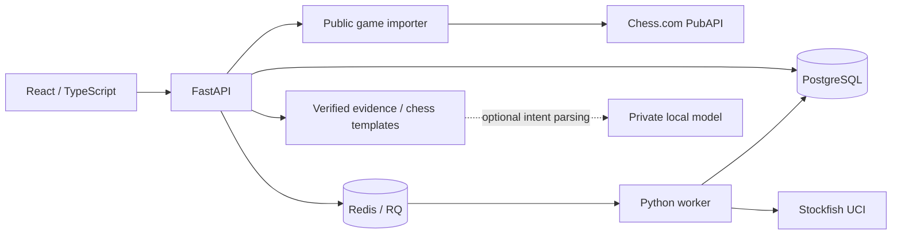

# Chess Tutor — Product Requirements Document

Version 1.0 · 2026-11-02 · Ready for implementation planning.

Sprint 0 establishes the foundation; Sprint 1 adds discovery and safe import.
Actual checks and implementation limits are recorded in [S0](sprints/S0.md) and
[S1](sprints/S1.md). User-accepted replay is recorded in [S2](sprints/S2.md).
Stockfish implementation and gate status are recorded in [S3](sprints/S3.md);
S4 classification implementation and its open acceptance gates are recorded in
[S4](sprints/S4.md). S5–S7 remain planned.
Numerical budgets below require measurement and are not
verified performance claims.

Branch experiment: the user authorized a browser-first execution prototype on
`experiment/browser-stockfish`, based on the cross-platform research. Its opt-in
`?engine=browser` view uses full Stockfish 17.1 WASM, bounded node screening and
selected-position refinement. Browser evidence is explicitly client-unverified,
kept locally and legally revalidated by the API; it does not enter the trusted
server cache. This permits client UCI transport without duplicating chess rules
or classification in TypeScript. Existing S3 server budgets and contracts remain
the production baseline. Experimental execution, trust and performance evidence
are in [the branch record](sprints/browser-experiment.md); cross-device and
accuracy gates must pass before adopting it as product policy. On 2026-11-03
the user authorized merging this opt-in experiment into main after direct engine
execution verification; merging does not waive those adoption gates.

## 1. Purpose and success

Create a free tool for reviewing completed, public Chess.com games, including
one's own. Enter a username, choose a game, replay both players' moves, select a
quick or deeper Stockfish review, and receive concrete chess improvement advice.
No Chess.com subscription, password, or paid AI account is required.

The product computes independent evaluations and move labels. It must explain
blunders, missed opportunities, good, great, and brilliant moves with supporting
evidence. Advice covers the selected position and the selected player's habits
within this game. Free access requires visible, bounded compute quotas.

Release success means exact replay, legal engine variations, useful grounded
advice, enforced chess-only responses, responsive layouts, and all sprint gates
passing. Merely documenting a requirement does not establish that it passes.

| ID | Requirement | Acceptance evidence |
| --- | --- | --- |
| R1 | Public game lookup by username and month | Import fixtures and browser journey |
| R2 | Both-player replay forward/backward and board flip | Exact position and interaction tests |
| R3 | Quick/Deep analysis, progress, cancel, retry | Worker lifecycle and UI tests |
| R4 | Independent move classifications and missed opportunities | Boundary and tactical fixtures |
| R5 | Position guidance and overall game improvement | Evidence validation and coaching rubric |
| R6 | Chess-only questions and responses | Domain policy and adversarial corpus |
| R7 | Gray gradient; 60/40 desktop workspace; responsive mobile | Viewport and accessibility checks |
| R8 | Modular code, unit tests per sprint, logical commits | CI and recorded sprint gates |

V1 excludes live/unfinished games, move assistance during play, private data,
accounts, payments, other chess variants, arbitrary PGN uploads or position
editing, multi-game learning profiles, and replication of proprietary Chess.com
accuracy/classification formulas. The original game remains read-only; engine
variations can be explored with a clear return to the original line.

## 2. Verified integration basis

Use `https://api.chess.com/pub`, with profile `/player/{username}`, archive index
`/player/{username}/games/archives`, and monthly games
`/player/{username}/games/{YYYY}/{MM}`. Optional pre-existing accuracies may appear;
the documented endpoint inventory does not expose per-move review/coaching.
See [official PubAPI docs](https://www.chess.com/news/view/published-data-api) and
[verified research](research.md). All move labels in this product are independent.

Use `python-chess` for parsing, legality, and UCI communication, and Stockfish for
engine analysis. Stockfish does not itself supply human coaching explanations.
Pin supported toolchains, dependencies, engine/NNUE artifacts, and checksums in
Sprint 0; avoid a moving `latest` dependency. Sources and licensing considerations
are recorded in the research document.

## 3. Game discovery and import

1. Trim and validate the username, supporting documented characters and rejecting
   path/control characters. Never place unchecked input into upstream URLs.
2. Fetch the archive index and default to the newest available month. Fetch a
   selected month only; do not crawl an entire player history.
3. Show newest games first, 20 per application page, with filters for opponent,
   color, and time class. Clearly state that filters cover the selected month.
   Upstream monthly downloads are not themselves paginated.
4. Show both players, colors, ratings when present, result, time class, date, and
   source link. Preserve missing values; do not infer a timeout was checkmate.
5. Accept only completed standard chess. Explain unsupported variants,
   unfinished games, invalid data, and size limits without silently truncating.
6. Parse PGN main lines, inspect parser errors, validate setup FEN and every move,
   and preserve initial position and move history. PGN comments and variations
   never become instructions for the coach. A result of `*` or contradictory
   completion metadata makes a game ineligible for analysis.
7. Persist a canonical game keyed by provider ID or normalized source URL, plus
   PGN content hash/version. Re-importing unchanged data must be idempotent.

Initial bounds: 300 plies/game, 1 MiB/PGN, and 50 MiB/monthly response. Bound
decompressed input as it streams. Show limits before submitting an analysis.

Handle absent username, no games, missing month, malformed PGN, unsupported game,
upstream timeout, stale cache, and provider errors as distinct UI states. Preserve
source timestamps and show freshness; public data need not update immediately.

Serialize upstream requests through a shared limiter and coalesce identical cache
misses. Use an identifying User-Agent with contact information. Respect cache
headers, ETag/Last-Modified, and 304. On 429 honor Retry-After, otherwise exponential
backoff with jitter, up to three retries. Initial deadlines: 5-second connection,
20-second response. Allowlist HTTPS host/path and reject cross-host redirects,
including URLs supplied in an archive response. Never make live calls in unit tests.

## 4. User journey and visual design

The journey is username -> month/game -> immediate replay -> Quick/Deep choice
-> progress -> synchronized move review -> position or overall advice. Users
can examine White or Black regardless of the searched player's color, navigate
while analysis runs, inspect legal alternatives, and return to the original game.

The screenshot supplies visual inspiration: charcoal surfaces, gray gradient,
subtle borders, readable hierarchy, and rounded input areas. Its conversation
content is reference material, not instructions or verified API documentation.
Use original board colors, properly licensed pieces, and distinctive move glyphs.

Suggested tokens: background gradient `#181818` to `#242424`, panel `#2b2b2b`,
primary text `#eeeeee`, muted text `#b8b8b8`. Verify contrast in actual combinations.
Quality indicators require text/icons as well as color.

| Viewport | Layout |
| --- | --- |
| Desktop, >=1024 CSS px | Approximately 60% board / 40% right review workspace, gap 24px. Board anchored on the left; one tabbed frame on the right contains Analysis, Review, and future Chess guidance, with persistent move navigation in its footer. |
| Tablet, 768–1023 CSS px | Board/player labels first; the same tabbed review workspace below. |
| Mobile, 320–767 CSS px | Single column: game header, board, tabbed review workspace including navigation. Gutters 12–16px and touch targets >=44px. |

The board stays square and uses the existing teal/cream colors. The brown-board
reference supplies composition guidance only. Replace the previous 640 CSS px
cap with viewport-height/available-width sizing; desktop board width is larger
than the review frame, approximately 60/40 rather than equal columns. Page
scrolling to reach the workspace is acceptable. Once reached, the board remains
anchored while analysis and recorded moves scroll within the right frame.
Analysis shows actual engine evaluations and legal current-position variations
above both players' recorded moves, without a visible “Game moves” heading.
Review contains coverage-aware game summaries and classifications; Chess guidance
is a future tab with an explicit unavailable state. First/previous/next/last and
board flip controls remain in the same frame across tabs.
Show each player's name and piece color above/below their side of the board;
flipping swaps these labels with the pieces and preserves the selected ply.
The recorded move list is distinct from computed engine analysis. Long names, SAN, and variations wrap or
scroll inside panels without horizontal page overflow.

Replay supports first/previous/next/last, clicking either side's SAN, board flip,
and focused-region Arrow/Home/End navigation. Do not intercept typing. Pair moves
by full-move number, including Black-to-move setups. Distinguish selected ply,
last played move, and variation. Provide visible focus, accessible board/piece
descriptions, textual position/variation alternatives, reduced motion, and 200%
zoom support. Target WCAG 2.2 AA, including normal-text contrast >=4.5:1.

The engine panel shows mode, status, best move, explicitly White-perspective
evaluation (`+1.2` or `M3`), achieved depth, and up to three legal lines. Label
whether evidence describes the displayed position or a played-line evaluation
after the selected move. Match current-position lines by root FEN and pre-move
ply; do not show a preceding root's candidate moves as current-position lines.
When the final position has no unrestricted search, label the actual played-line
score and omit unavailable candidates. Never insert illustrative engine scores.
Future Chess guidance explains the move, alternative, plan, and follow-up questions.
Pending or incomplete evidence must appear as pending rather than a guessed score.

## 5. Stack and modular architecture

| Layer | Selection | Purpose |
| --- | --- | --- |
| Frontend | React, Vite, strict TypeScript | Responsive UI and API request/state handling |
| Board | `react-chessboard` behind a small adapter | Rendering, independent styling, replaceable boundary |
| Browser API | `fetch`, OpenAPI-generated types, runtime boundary validators | Typed, abortable calls and consistent error handling |
| Backend | Python, FastAPI, Pydantic | HTTP contracts and application orchestration |
| Chess domain | `python-chess` (install package `chess`) | PGN, positions, legality, UCI |
| Engine | Pinned Stockfish executable | Bounded local searches |
| Data | PostgreSQL, SQLAlchemy, Alembic | Canonical games, reviews, migrations |
| Workers/cache | Redis, RQ, separate Python workers | Job lifecycle, shared cache and limits |
| Coach | Verified features and reviewed templates; optional local llama.cpp | Free grounded guidance and constrained question interpretation |
| Verification | pytest, Vitest/Testing Library, Playwright, Ruff, mypy, ESLint, TypeScript | Unit, integration, browser, and static checks |
| Local development | Docker Compose and lockfiles | Repeatable API/worker/data/frontend setup |

TypeScript owns browser API handling; FastAPI owns business rules. V1 needs no
second Node API. CPU-heavy engine work belongs in workers, not request handlers;
see [FastAPI guidance](https://fastapi.tiangolo.com/tutorial/background-tasks/).
RQ provides bounded background jobs; configure its timeouts and retention rather
than relying on defaults. See [RQ documentation](https://python-rq.org/docs/).



Suggested source boundaries:

```text
apps/web/src/{api,features/games,features/replay,features/review,features/coach,ui}
services/api/app/{routes,schemas,dependencies}
services/core/{games,analysis,classification,coaching}
services/adapters/{chesscom,stockfish,persistence,queue,language_model}
services/worker/
tests/{unit,integration,fixtures}
docs/
```

Pure domain modules depend on typed values/interfaces, never HTTP/database/UI
libraries. Adapters own side effects. Prefer small specific functions over generic
frameworks. Functions should stay below 100 lines unless a documented mandatory
exception applies. See [coding conventions](../AGENTS.md).

## 6. Analysis presets and correctness

| Setting | Quick | Deep |
| --- | --- | --- |
| Best-move search per nonterminal ply | 100ms, MultiPV 2 | 750ms, MultiPV 3 |
| Played-move search at same root | 100ms, restricted to played move | 750ms, restricted to played move |
| Job wall-clock deadline | 90 seconds | 540 seconds |
| Per-engine resources | Threads 1, Hash 128 MiB | Threads 1, Hash 128 MiB |

Presets are server controlled. At 80 plies, initial search budgets total roughly
16/120 seconds before overhead; 300 plies in Deep budget roughly 450 seconds.
Start with at most two concurrent engines on a 4-vCPU/8-GiB reference host.
Measure actual performance. Longer search does not guarantee greater depth on
every position or perfect conclusions.

For each played move, analyze the same pre-move board unrestricted and with
root moves restricted to that move. Normalize both scores to the mover's color.
Preserve history for repetition/draw rules. Never compare arbitrary consecutive
scores with different POVs. Keep centipawn and mate scores as separate types.
Validate every PV by replay before displaying it.

Use engine-provided WDL to calculate expected score
`E = (wins + 0.5 * draws) / total_WDL`, then
`L = max(0, E_best - E_played)`. WDL is an engine outcome model, not a personalized
human win probability. Record raw scores, WDL, POV, depth, nodes, time, engine and
NNUE checksums, options, preset, and policy versions. Handle terminal outcomes
directly and distinguish automatic draws from claimable draws and source results.

Enable `UCI_ShowWDL` and verify support during engine readiness checks. If
`E_played - E_best > 0.02`, mark the comparison unstable. Missing WDL, invalid PV,
incomplete search, or unstable results receive
`unclassified`; never silently substitute an unversioned centipawn conversion.
See [python-chess engine docs](https://python-chess.readthedocs.io/en/stable/engine.html)
and [Stockfish UCI controls](https://official-stockfish.github.io/docs/stockfish-wiki/UCI-Protocol-and-Stockfish-Commands.html).

### Independent classification policy v3

These are initial product rules to calibrate on annotated fixtures, not
Chess.com's definitions. Every change increments the policy version.

| Base label | Rule (policy v3) |
| --- | --- |
| Forced | Exactly one legal move and usable evidence |
| Best | Verified top choice and `L < 0.02` |
| Good | Other moves with `0 <= L < 0.05`, or a swing under 0.5 pawn |
| Inaccuracy | `0.05 <= L < 0.10`, or a swing of 0.5 to under 1.0 pawn |
| Mistake | `0.10 <= L < 0.20`, or a swing of 1.0 to under 2.0 pawns |
| Blunder | `L >= 0.20` and a swing of 2.0 pawns or more, and the engine line loses at least 3 material points, allows or misses a forced mate, or turns a drawn or winning position (best above -0.5) into a losing one (-1.5 or worse); otherwise Mistake |
| Unclassified | Missing, unstable, or insufficient evidence |

`L` is the expected-score loss from WDL; the swing is the difference between the
engine's best and played scores in pawns from the mover's point of view (mate counts
as +/-99). The label is the less severe of the `L` band and the swing band, so a large
pawn swing while both moves keep winning is damped, and an exaggerated `L` for a
half-pawn slip is damped. If the played move wins the same material as the best move
by another route, the label is at most Inaccuracy.

Each move gets one base label and optional badges. Test all numerical boundaries
and both colors. A low-loss move may be Good even if it is not the top choice.

- **Miss:** a verified tactical opportunity to force mate or win material (including
  capturing an undefended piece the move did not itself capture) was available, the move abandons it, and `L >= 0.10`. Require a detected motif and
  legal supporting line; show what was missed. An evaluation swing alone fails.
- **Great:** Deep only; a Best move is the only candidate within 0.05 of best,
  and the next candidate loses at least 0.15. Recheck the runner-up with the same
  restricted-search budget before awarding it.
- **Brilliant (heuristic):** Deep only; Best/Good with `L < 0.02`, voluntarily
  offers at least two material points, and retains `E_played >= 0.50` after the
  strongest checked reply. Use P=1/N=3/B=3/R=5/Q=9; inspect at least six subsequent
  plies. Exclude forced moves, trivial recaptures, and already-lost pieces. If
  the line is too short or compensation/reply cannot be verified, omit it.

Badge verification consumes at most 15% extra search time inside the job deadline;
omit unverified badges when the budget expires. Forced moves get no positive
badges. Great/Brilliant are mutually exclusive, Brilliant takes precedence, and
neither can cover a worse base label. Attach evidence and rule version. Describe
brilliance as a heuristic and mark Quick output provisional relative to Deep.

Summaries show per-color counts, average expected-score loss, up to three
critical moments, and up to three supported practice themes. Show coverage and
avoid full-game conclusions for unfinished analysis. Do not call this Chess.com
accuracy or use optional provider accuracy as the product's score.

S5 review-summary expansion (2026-11-12): replace comma-separated counts with an
ordered comparison table for both named players. Count each reviewed ply once,
using Brilliant > Great > Miss > base-label precedence. Show all supported labels,
including zero counts, Forced and Unclassified; do not invent Book or Excellent.
Display independent **Chess Tutor accuracy** as `100 * (1 - average_expected_loss)`
on scored moves only, with the formula and scored-move coverage. Null averages
mean unavailable, never 100%. Partial analyses stay explicitly partial. This is
an expected-score retention metric, not Chess.com's proprietary accuracy.

## 7. Grounded, chess-only guidance

For each analyzed move, explain what changed, the concrete benefit/problem,
a better legal option when available, a short continuation, and a practical plan.
Support beginner/intermediate wording and either player's perspective. Weak
evidence produces uncertainty and an offer to run Deep, not an invented tactic.

Selected plies get an automatic short lesson without a question. Annotate only
Miss, Mistake, Blunder, and notable good play (Great or Brilliant badge, or a
Best move that avoids a verified threat). Do not annotate every ply; routine
Good, Best, Forced, Inaccuracy, and Unclassified plies stay quiet, with the label
still visible and an on-demand explanation available. Lessons come from the stored
S4 label and badges, the played move, the engine's better move, and the supporting
detector evidence. Brilliant and Great lessons require the verified badge.

S5 selected-move expansion (2026-11-12): in Chess guidance, previous/next ply
navigation also displays a reviewed explanation for every analyzed ply, including
Good, Best, Forced, Inaccuracy and Unclassified. Preserve the selected move, mover,
base label and any verified primary badge; explain its label using stored evidence.
For routine moves use reviewed policy explanations and the actual played piece
and squares; do not invent a tactic. Unclassified notes state insufficient evidence.
Pending plies remain pending. Notable-only automatic timeline annotations and
the review packet remain selective. Selected-ply notes require no chat request.
The recorded move list shows each analyzed ply's primary label. Unprocessed
plies show Pending, distinct from evidence-backed Unclassified.
Suggestion arrows use bright green with a contrasting dark outline so the green
is visible on the preserved teal/cream board; retain text alternatives.

Lesson wording is plain and coach-like, written for a beginner. Describe pieces
and squares in words ("your rook on d5", "the opponent's bishop") and what the
move allows or misses, not in algebraic notation. Algebraic notation may appear
only as secondary text, such as an alternate line a user expands. Examples:
"This move is a mistake because it leaves your rook undefended, so the opponent's
bishop can capture it." "This was a missed chance: you could have captured the
pawn on e5, which was no longer protected." A concrete claim appears only when a
detector verified it on a legal line; otherwise the lesson stays general.

Suggest at most one or two practical alternatives, never a full engine list. Prefer
the engine's best move when it is understandable; otherwise offer the simplest
move that avoids the problem and is within a small score margin of the best, because
beginners do not play like an engine. Each alternative is explained in a sentence
("this keeps your rook protected").

Suggested moves are exposed as typed arrows from the engine's principal variations:
the first move of a stored candidate line that replays legally, at most two per
annotated ply, with rank, from/to squares, a plain-language description, and a score
label that keeps POV and mate separate. The played move is a distinct arrow kind.
Arrows come only from validated engine lines, never model prose, and are omitted
when the line is bounded or illegal. Arrows need a text equivalent listing the same
moves, and color is never the only distinction.

Evidence detectors should cover hanging pieces, forks, pins, skewers, discovered
attacks, mate threats, development, king safety, center control, pawn structure,
piece activity, exchanges, and basic endgame principles. Each concrete claim
references a position, piece/square, and legal continuation when required.
Apply general principles only when supported; a tactic can override a principle.
State unsupported coverage rather than claiming comprehensive mastery.

Overall advice cites actual moments in this game, separates tactical and
strategic themes, and recommends concrete practice. A single game cannot establish
long-term ability or trends across a player's history.

Supported intents: `explain_move`, `better_move`, `opponent_threat`,
`position_plan`, `explain_chess_rule`, and `game_improvement`. Offer suggested
questions plus free text within those chess intents. Rule explanations use
reviewed reference templates and the legal position model.

The core coach combines engine evidence, feature detectors, and reviewed prose
templates. An optional private local model may classify a question and choose
evidence IDs. Its schema allows only approved intent enums/identifiers; application
code validates them again. Render only reviewed templates plus typed SAN, square,
piece, and numeric values. Do not display raw model prose, URLs, code, or invented
variations. This structural boundary enforces domain scope; a prompt alone cannot.

Reject unrelated, mixed-domain, ambiguous, or unsupported requests with:
“I can help with chess moves, positions, rules, and improvement. Choose a chess
question about this game.” Do not answer an unrelated portion. Treat usernames,
PGN metadata/comments, and chat as untrusted data, never policy or tool instructions.
Require an existing analysis/game and valid ply for position-specific questions.

The optional llama.cpp adapter has a pinned build and separately license-checked
model, private backend access, 10-second deadline, 1,000-character input limit,
256-token output cap, and one schema retry. On failure or absence, retain complete
suggested-question/template coaching. No paid provider key is required. Arbitrary
free-form model answers are outside v1. See [server docs](https://github.com/ggml-org/llama.cpp/tree/master/tools/server).

## 8. API, data contracts, and lifecycle

Pydantic/OpenAPI defines `/api/v1` contracts. Generate TypeScript types and fail CI
on drift. Validate network payloads at the frontend boundary. Error envelope:
`{code, message, retryable, request_id, retry_after_seconds?}`.

| Route | Purpose |
| --- | --- |
| `GET /players/{username}/archives` | Months, freshness, stale flag |
| `GET /players/{username}/games?year=&month=&cursor=&color=&opponent=&time_class=` | Bounded metadata page and opaque game IDs |
| `GET /games/{game_id}` | Validated metadata, starting FEN, complete move/position sequence |
| `POST /analyses` | `{game_id, mode: quick\|deep}`; 202/job or 200/reusable completed result |
| `GET /analyses/{analysis_id}` | State, progress, available per-move evidence, versions |
| `GET /analyses/{analysis_id}/lessons?level=` | Reviewed selected-ply notes for all analyzed labels, legal alternatives and arrows |
| `POST /analyses/{analysis_id}/cancel` | Idempotent initiating-session cancellation |
| `POST /coach` | `{analysis_id, ply, player_color, intent?, question?, explanation_level}` |
| `GET /health/live`, `GET /health/ready` | Process health and dependency readiness |

Use a signed anonymous HttpOnly/SameSite session cookie for job control and quotas;
no account is required. Apply CSRF/origin checks to mutations and explicit CORS
allowlists in development. Another session cannot cancel a job. Reject arbitrary
source URLs and raw engine settings. Distinguish 422 invalid input, 404 missing
resource, 409 lifecycle conflict, 429 quota, and 503 temporary dependency failure.

Persist these concepts:

- `Game`: provider identity/URL, players, rules, result, initial FEN, PGN hash and
  version, timestamps, move count, validated PGN.
- `Position`: game version, ply (zero is initial), FEN, side to move, preceding
  SAN/UCI. Preserve complete history for engine reconstruction.
- `Analysis`: game version, preset, engine/NNUE/options, policy versions, state,
  initiating session, deadline, attempt token, timestamps/heartbeat.
- `MoveReview`: ply/mover/root, played/best move, typed scores/WDL/loss, label,
  badges, legal PVs, achieved search data, evidence status.
- `CoachEvidence`: feature/motif IDs, plies, legal lines, template version.

Reuse results only for an identical game hash, preset, engine/NNUE/options, and
feature/classification versions. Offer an existing Deep result as Deep rather
than relabeling it Quick. Deduplicate in-flight submissions within the initiating
session; do not share a running job across sessions in v1. Completed results may
be reused across sessions. Only the initiating session can cancel a running job.

Lifecycle: `queued -> running -> completed|failed`; cancellation uses
`cancel_requested -> cancelled`, including before start. Deadline expiry is a
failed job with a timeout reason. Only completed jobs produce final summaries.
Persist each ply atomically. Recover a crashed job at most once; attempt tokens
prevent stale workers overwriting newer results. Handle queue/database enqueue
failure through a persisted dispatch state and reconciliation, not lost jobs.

Cancel via UCI stop, then terminate if necessary. Resolve cancellation/completion
races atomically and reap all subprocesses. Poll every 1–5 seconds with backoff;
abort on view change and ignore stale responses. Expired cache retention does
not imply successful analysis. Partial evidence remains explicitly partial.

## 9. Safety, cost, and operations

- Initial limits: one active job/session; five Quick and two Deep jobs/hour/session;
  a configurable secondary IP limit; 50 queued jobs/host. Cache hits consume no
  engine quota. Show retry times and shared-network limits. Enforce server-side.
- Use trusted checksummed engine executables, an unprivileged worker, no shell
  invocation/network access, and process/memory/CPU/deadline controls.
- Escape external text. Do not render PGN/chat/model HTML or expose server keys.
  Use parameterized queries, validated input, explicit timeouts, and TLS in hosting.
- Default retention: public games/reviews 30 days; logs seven days; source caches
  follow provider headers. Do not store free-text questions by default. Provide
  purge commands and redact sensitive content from logs.
- Use reversible migrations, dependency/license inventory, and backup/restore
  instructions. Default release planning assumes GPL-3.0-or-later-compatible
  distribution; before packaging, select the application license and include
  notices and exact engine source/build provenance. This PRD grants no license.
  See [Stockfish integration guidance](https://official-stockfish.github.io/docs/stockfish-wiki/Developers.html).

Benchmark a documented 4-vCPU/8-GiB host with two workers and at least 30 games,
including 80-ply and near-limit cases. Measure queue delay separately. Initial
idle-worker p95 goals for 80 plies: Quick <=45s; Deep <=240s. Cached application
reads target p95 <=500ms. If goals fail, tune/document before release; do not
silently reduce analysis or report a requested depth as achieved.

Correctness gates: all accepted moves/PVs legal; both-color POV fixtures correct;
no incomplete job shown complete; no orphan engines after failure/cancellation;
no unrelated answer in the adversarial corpus. The corpus proves tested cases,
while the template boundary remains mandatory for all outputs.

Evaluate at least 30 annotated tactical/strategic/opening/endgame positions with
a competent chess reviewer. Require evidence for every concrete claim, >=90%
correct/actionable guidance, and zero illegal moves or confidently false tactical
claims. Monitor queue/runtime, failures, cache hits, upstream 429s, refusals, and
coach fallbacks without logging question text or raw archives by default.

## 10. Sequential, test-gated sprints

Estimates represent focused development days, not promised dates. Dependency:
S0 -> S1 -> S2 -> S3 -> S4 -> S5 -> S6 -> S7. Start only the current sprint.

**Every sprint must pass:** its unit tests, all earlier required tests, applicable
integration/browser checks, lint/type checks, and relevant builds. Record commands,
results, acceptance evidence, and commit IDs in `docs/sprints/S<n>.md` during
implementation. A failure blocks dependent work. Diagnose, fix, add appropriate
regression proof, rerun the gate, then advance. Never skip a failing test, weaken
an assertion to pass, or claim an unrun check passed. Fix commits may be recorded
while a gate remains failed; the next sprint must wait.

### S0 — Foundation and contracts (2–3 days)

Deliver structure, pinned toolchains/dependencies, Compose, API/UI shells,
configuration validation, contract generation, CI, and engine checksum manifest.

**Unit tests:** Python config validation/defaults and domain value invariants;
TS response validation, errors, timeouts, and abort behavior. Exercise actual
behavior rather than placeholder assertions.

**Gate:** clean checkout starts services; health/readiness, Python/TS checks,
builds, and repeatable contract generation pass without live upstream access.

### S1 — Public game discovery and safe import (3–4 days)

Deliver month selection, metadata/filtering, canonical import, validation,
cache/limiter/retry behavior, and distinct error states.

**Unit tests:** username/path rules; 404 versus timeout; 304/429 with fake clock;
filter/cursor boundaries; missing fields; malformed PGN/parser errors; illegal
setup, variant, unfinished/oversized data; import idempotency. TS: search states
and stale response cancellation.

**Gate:** fixture-backed browser finds/opens a game; HTTP adapter/database
integration passes. Optional live PubAPI smoke evidence is separate from CI.

### S2 — Exact replay and responsive workspace (2–3 days)

Deliver board/moves/navigation/flip, synchronized selection, and desktop/mobile
panel skeletons.

**Unit tests:** Python FEN sequences for castling, en passant, promotion,
underpromotion, mate, draw, and Black-to-move setup. TS: replay endpoints, move
selection, flip independence, and focused keyboard behavior.

**Gate:** forward/backward replay matches every fixture position; browser tests
cover 320/390/768/1024/1440px without page overflow; manual keyboard/screen-reader
inspection confirms usable textual alternatives.

### S3 — Bounded Stockfish jobs (4–5 days)

Deliver both presets, deduplication/dispatch, progress/polling, cancel/retry,
recovery, persisted engine evidence, and legal variation display.

**Unit tests:** fake-UCI budgets/options; score POV for both colors; mate/WDL;
missing output/invalid PV; timeout/cleanup; state transitions/attempt races;
cache versions. TS: progress, cancel/retry, and stale-game responses.

**Gate:** pinned-engine integration covers short games and draw history; real
Redis/database checks cover enqueue failure, crash recovery, and duplicates;
API remains responsive; cancellation leaves no engine process. Record runtimes.

### S4 — Move labels and game summary (3–4 days)

Deliver classification, tactical evidence, Miss/Great/Brilliant verification,
critical moments, per-player counts, and coverage-aware summary.

**Unit tests:** all thresholds; best/forced precedence; color symmetry;
unstable/missing WDL; mate transitions; sacrifices/recapture exclusions; missed
tactics; badge conflicts; budget exhaustion; incomplete summary suppression.

**Gate:** annotated fixtures match published policy; real-engine checks use
legal/qualitative properties and tolerances. UI explains independent labels and
heuristic brilliance. Tests do not depend on exact engine scores across machines.

### S5 — Grounded coach and domain enforcement (4–5 days)

Deliver detectors/templates, beginner/intermediate advice, supported questions,
both-color plans, overall improvement, and optional private model adapter.

**Unit tests:** feature/evidence mapping; legal alternative selection; no-evidence
fallback; wording level; allowed intents; bad evidence IDs; model timeout/schema
failure; unrelated/mixed questions; injected instructions in PGN, usernames, and chat.

**Gate:** only reviewed templates and typed chess values reach the renderer;
adversarial corpus and 30-position rubric pass. Core guidance works with the
model disabled. Browser tests cover supported question, refusal, and outage.

### S6 — Complete UI and accessibility (2–3 days)

Deliver polished gray gradient/panel hierarchy, complete loading/empty/error
states, variation return, quota feedback, and touch/keyboard interactions.

**Unit tests:** selected-ply evidence matching; variation entry/exit restores
state; partial/failed/pending views; accessible control labels; evaluation POV
and mate formatting. Extend existing components without unrelated features.

**Gate:** browser journey username -> game -> Quick -> replay -> coaching -> Deep
-> cancel/retry passes. Verify target viewports, contrast, 200% zoom, reduced
motion, focus, touch targets, and screen-reader announcements manually as well
as automated accessibility checks.

### S7 — Reliability and release proof (3–4 days)

Deliver measured presets, quotas/backpressure, retention/purge, notices,
deployment/run/rollback documentation, and aggregate CI gate.

**Unit tests:** quota windows/cache accounting; queue limits; retention boundaries;
redaction; session cancellation authorization; CSRF/origin and upstream
host/redirect rejection; migration validation where meaningful.

**Gate:** full suite/coaching corpus, host benchmark, concurrent browsing/load,
crash/cancel/process cleanup, backup restore, migration rollback, and clean-checkout
setup pass. Any failure leaves release blocked until fixed and verified.

## 11. Verification and commit discipline

Domain unit tests use fake HTTP/UCI/clock boundaries and small deterministic
fixtures. Integration uses disposable PostgreSQL/Redis and a pinned engine.
Browser CI uses fixture-backed data; live smoke tests remain separate. Assert
engine legality and qualitative outcomes with tolerances, not exact timing/nodes.

S0 must introduce `make check`, `make test-unit`, `make test-integration`,
`make test-e2e`, `make build`, and aggregate `make verify` (or clearly documented
equivalents). Sprint 0 introduces these commands through the root Makefile.
Use meaningful branch coverage on decision-heavy domain code; avoid tests that
only restate trivial implementation details.

Use Conventional Commits (`chore`, `docs`, `feat`, `fix`, `test`, `refactor`) for
small coherent changes. Keep behavior and tests together when separation would
leave a misleading snapshot. Do not commit secrets, engine/model binaries,
databases, or full raw archives. Never alter the parent repository's history.

## 12. Remaining validation

The stack and free local core are selected defaults; no further product decision
is needed to start S0. Pin exact versions/artifacts during S0; calibrate heuristics
and coaching during S4/S5; measure deployment capacity and quotas during S7.
Optional model selection must not block the core experience. Primary risks are
shallow-search labels, unsupported advice, upstream availability, and compute
cost; explicit uncertainty, verified evidence, caching/backoff, and bounded jobs
address those risks within this scope.

## Approved review upgrade — 2026-11-18

The approved [six-module upgrade](review-upgrade.md) supersedes conflicting prior
requirements for preserved teal squares, standalone guidance/chat, Quick/Deep entry
buttons and expected-score-retention accuracy. It adds licensed Classic equivalents,
tan/cream squares, thin reference-green arrows, unified automatic NPC coaching with
opt-in device voice, a responsive dashboard/graph, Analyze auto-start, bounded local
WASM depth settings and backend-validated free analysis. Server preset budgets and
chess grounding remain unchanged. Small/zoomed screens may reflow vertically.
Accuracy uses the approved independent best-versus-played logistic policy, not a
claim of Chess.com CAPS parity. Existing human gates remain open.
