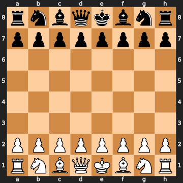
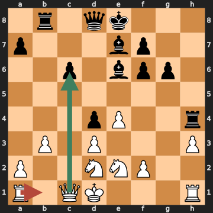
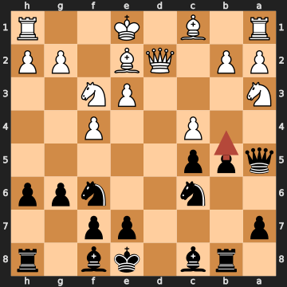
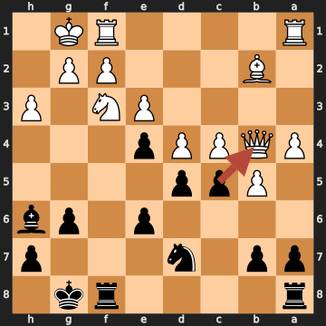
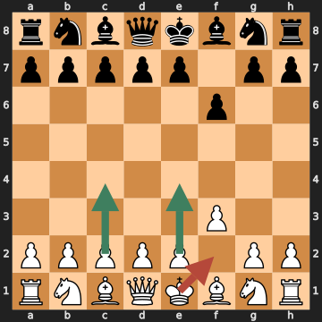
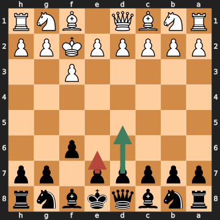
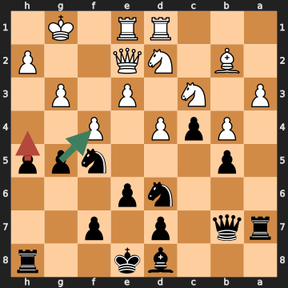
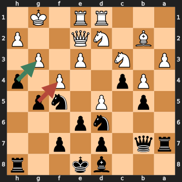
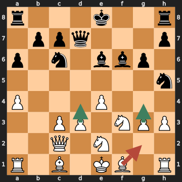

# S5 human coaching review sheet

Gate (plan.md S5, PRD section 7): human review of at least 30 positions, at least 90% correct and actionable (27 of 30), and zero illegal moves or confidently false tactical claims. Control rows check that quiet moves stay quiet.

Provenance: Stockfish 19, deep preset, one thread, seed 5. 30 annotated + 6 control positions. Script checks (legality, notation, counts): 36 of 36 pass.

How to review: read the board and the coach note. Mark *correct and actionable* only if a beginner would be told something true and useful. Mark the second column Y if any suggested move is illegal or any claim is false or overconfident. Notation appears here for you only; the learner sees plain words.

Tally: annotated rows with Y in the first column divided by annotated rows must be at least 0.90, and the second column must contain no Y.

### 1 · G1 ply 1 · White · Routine (good)

- Position before the move (FEN): `rnbqkbnr/pppppppp/8/8/8/8/PPPPPPPP/RNBQKBNR w KQkq - 0 1`
- Played: **b4**; engine's first choice: **d4**
- Stored label: good; expected-score loss 4%; badges: none
- **No note shown** (routine move). The learner sees nothing for this move.
- Script checks: pass

| Silence appropriate (Y/N) | Missed an obvious problem (Y/N) | Comments |
| --- | --- | --- |
|  |  |  |

### 2 · G1 ply 4 · Black · Routine (inaccuracy)

- Position before the move (FEN): `rnbqkbnr/pp1ppppp/2p5/8/PP6/8/2PPPPPP/RNBQKBNR b KQkq - 0 2`
- Played: **c5**; engine's first choice: **e5**
- Stored label: inaccuracy; expected-score loss 11%; badges: none
- **No note shown** (routine move). The learner sees nothing for this move.
- Script checks: pass

| Silence appropriate (Y/N) | Missed an obvious problem (Y/N) | Comments |
| --- | --- | --- |
|  |  |  |

### 3 · G1 ply 5 · White · Routine (best)

- Position before the move (FEN): `rnbqkbnr/pp1ppppp/8/2p5/PP6/8/2PPPPPP/RNBQKBNR w KQkq - 0 3`
- Played: **bxc5**; engine's first choice: **bxc5**
- Stored label: best; expected-score loss 0%; badges: none
- **No note shown** (routine move). The learner sees nothing for this move.
- Script checks: pass

| Silence appropriate (Y/N) | Missed an obvious problem (Y/N) | Comments |
| --- | --- | --- |
|  |  |  |

### 4 · G1 ply 14 · Black · Miss

- Position before the move (FEN): `r1bqkb1r/p2p1ppp/1pn2n2/2P1P3/P7/B1P5/4PPPP/RN1QKBNR b KQkq - 0 7`
- Played: **Ne4**; engine's first choice: **Nxe5**
- Stored label: inaccuracy; expected-score loss 15%; badges: miss
- **Coach note:** This was a missed chance. Your knight on c6 takes the undefended pawn on e5, winning material for free.
- Suggestion 1 (reviewer notation Nxe5): Consider moving your knight from c6 to e5, which captures the opponent's pawn.
- Script checks: pass

| Correct and actionable (Y/N) | Illegal or confidently false claim (Y/N) | Comments |
| --- | --- | --- |
|  |  |  |

### 5 · G2 ply 16 · Black · Great

- Position before the move (FEN): `r1bqkb1r/pp2pp2/2n2Bpp/2p5/3p4/2PP2P1/PP2PP1P/RNQ1KBNR b KQkq - 0 8`
- Played: **exf6**; engine's first choice: **exf6**
- Stored label: best; expected-score loss 0%; badges: great
- **Coach note:** Great move! Your pawn on e7 takes the undefended bishop on f6, winning material for free. It was the only move that kept your advantage.
- Script checks: pass

| Correct and actionable (Y/N) | Illegal or confidently false claim (Y/N) | Comments |
| --- | --- | --- |
|  |  |  |

### 6 · G2 ply 21 · White · Great

- Position before the move (FEN): `r1bqkb1r/pp3p2/2n2pp1/2p5/3p3p/2PP2P1/PP1NPPBP/R1Q1K1NR w KQkq - 0 11`
- Played: **Bxc6+**; engine's first choice: **Bxc6+**
- Stored label: best; expected-score loss 1%; badges: great
- **Coach note:** Great move! Your bishop on g2 captures the opponent's knight on c6. It was the only move that kept your advantage.
- Script checks: pass

| Correct and actionable (Y/N) | Illegal or confidently false claim (Y/N) | Comments |
| --- | --- | --- |
|  |  |  |

### 7 · G2 ply 28 · Black · Great

- Position before the move (FEN): `r2qkb1r/p4p2/2p2pp1/2pb4/3PP2P/3P4/PP1N1P1P/R1Q1K1NR b KQkq - 0 14`
- Played: **Be6**; engine's first choice: **Be6**
- Stored label: best; expected-score loss 0%; badges: great
- **Coach note:** Great move! It rescues your bishop on d5, which was under attack. It was the only move that kept your advantage.
- Script checks: pass

| Correct and actionable (Y/N) | Illegal or confidently false claim (Y/N) | Comments |
| --- | --- | --- |
|  |  |  |

### 8 · G2 ply 35 · White · Mistake

- Position before the move (FEN): `1r1qk3/p3bp2/2p1bpp1/2p5/3PP2r/1P1P3P/P2NNP2/R1Q1K2R w KQ - 1 18`
- Played: **Kd1**; engine's first choice: **Nf3**
- Stored label: mistake; expected-score loss 48%; badges: none
- **Coach note:** This move is a mistake: the opponent gets a clear edge from it, and a stronger option was available.
- Suggestion 1 (reviewer notation Nf3): Consider moving your knight from d2 to f3, which is the strongest option here.
- Suggestion 2 (reviewer notation f4): Consider moving your pawn from f2 to f4, which is the strongest option here.
- Script checks: pass

| Correct and actionable (Y/N) | Illegal or confidently false claim (Y/N) | Comments |
| --- | --- | --- |
|  |  |  |

### 9 · G2 ply 36 · Black · Mistake

- Position before the move (FEN): `1r1qk3/p3bp2/2p1bpp1/2p5/3PP2r/1P1P3P/P2NNP2/R1QK3R b - - 2 18`
- Played: **cxd4**; engine's first choice: **f5**
- Stored label: mistake; expected-score loss 42%; badges: none
- **Coach note:** This move is a mistake because it leaves your pawn on c6 undefended, so the opponent's queen on c1 can capture it.
- Suggestion 1 (reviewer notation f5): Consider moving your pawn from f6 to f5, which leaves none of your pieces undefended.
- Script checks: pass

| Correct and actionable (Y/N) | Illegal or confidently false claim (Y/N) | Comments |
| --- | --- | --- |
|  |  |  |

### 10 · G2 ply 37 · White · Miss

- Position before the move (FEN): `1r1qk3/p3bp2/2p1bpp1/8/3pP2r/1P1P3P/P2NNP2/R1QK3R w - - 0 19`
- Played: **Rb1**; engine's first choice: **Qxc6+**
- Stored label: inaccuracy; expected-score loss 40%; badges: miss
- **Coach note:** This was a missed chance. Your queen on c1 takes the undefended pawn on c6, winning material for free.
- Suggestion 1 (reviewer notation Qxc6+): Consider moving your queen from c1 to c6, which gives check.
- Script checks: pass

| Correct and actionable (Y/N) | Illegal or confidently false claim (Y/N) | Comments |
| --- | --- | --- |
|  |  |  |

### 11 · G2 ply 39 · White · Miss

- Position before the move (FEN): `1r1qk3/p3bp2/2p2pp1/8/3pP1br/1P1P3P/P2NNP2/1RQK3R w - - 2 20`
- Played: **Rg1**; engine's first choice: **Qxc6+**
- Stored label: mistake; expected-score loss 43%; badges: miss
- **Coach note:** This was a missed chance. Your queen on c1 takes the undefended pawn on c6, winning material for free.
- Suggestion 1 (reviewer notation Qxc6+): Consider moving your queen from c1 to c6, which gives check.
- Script checks: pass

| Correct and actionable (Y/N) | Illegal or confidently false claim (Y/N) | Comments |
| --- | --- | --- |
|  |  |  |

### 12 · G3 ply 8 · Black · Miss

- Position before the move (FEN): `r1bqkbnr/ppp1ppp1/2n5/3P3p/8/4P1P1/PP1P1P1P/RNBQKBNR b KQkq - 0 4`
- Played: **Nb4**; engine's first choice: **Qxd5**
- Stored label: blunder; expected-score loss 58%; badges: miss
- **Coach note:** This was a missed chance. Your queen on d8 takes the undefended pawn on d5, winning material for free.
- Suggestion 1 (reviewer notation Qxd5): Consider moving your queen from d8 to d5, which captures the opponent's pawn.
- Script checks: pass

| Correct and actionable (Y/N) | Illegal or confidently false claim (Y/N) | Comments |
| --- | --- | --- |
|  |  |  |

### 13 · G4 ply 23 · White · Great

- Position before the move (FEN): `rn1qk2r/pp3ppp/2p1p1b1/3pb3/N1P1n1PP/1P2P3/PB1P1P2/R2QKB1R w KQkq - 0 12`
- Played: **Bxe5**; engine's first choice: **Bxe5**
- Stored label: best; expected-score loss 0%; badges: great
- **Coach note:** Great move! Your bishop on b2 takes the undefended bishop on e5, winning material for free. It was the only move that kept your advantage.
- Script checks: pass

| Correct and actionable (Y/N) | Illegal or confidently false claim (Y/N) | Comments |
| --- | --- | --- |
|  |  |  |

### 14 · G4 ply 26 · Black · Routine (good)

- Position before the move (FEN): `rn1qk2r/pp4pp/2p1ppb1/3p4/N1P1n1PP/1P2P3/P2P1P1B/R2QKB1R b KQkq - 1 13`
- Played: **h5**; engine's first choice: **h6**
- Stored label: good; expected-score loss 0%; badges: none
- **No note shown** (routine move). The learner sees nothing for this move.
- Script checks: pass

| Silence appropriate (Y/N) | Missed an obvious problem (Y/N) | Comments |
| --- | --- | --- |
|  |  |  |

### 15 · G4 ply 30 · Black · Mistake

- Position before the move (FEN): `rn1qk2r/pp4p1/2p2pb1/3pp2p/N1P1n1PP/1P2P3/P2P1P1B/2RQKBR1 b kq - 1 15`
- Played: **Nd6**; engine's first choice: **dxc4**
- Stored label: mistake; expected-score loss 48%; badges: none
- **Coach note:** This move is a mistake because it lets the opponent's pawn on c4 capture your pawn on d5, and you lose material.
- Suggestion 1 (reviewer notation dxc4): Consider moving your pawn from d5 to c4, which captures the opponent's pawn.
- Suggestion 2 (reviewer notation Nd7): Consider moving your knight from b8 to d7, which is the strongest option here.
- Script checks: pass

| Correct and actionable (Y/N) | Illegal or confidently false claim (Y/N) | Comments |
| --- | --- | --- |
|  |  |  |

### 16 · G4 ply 37 · White · Blunder

- Position before the move (FEN): `r2qk2r/pp4p1/n1p2pb1/3P3p/N2pn1PP/PP2P3/5P1B/2RQKBR1 w kq - 1 19`
- Played: **Qxd4**; engine's first choice: **Bxa6**
- Stored label: blunder; expected-score loss 45%; badges: none
- **Coach note:** This move is a blunder because it lets the opponent's queen go to a5, which gives them the better position.
- Suggestion 1 (reviewer notation Bxa6): Consider moving your bishop from f1 to a6, which captures the opponent's knight.
- Suggestion 2 (reviewer notation Bd3): Consider moving your bishop from f1 to d3, which is the strongest option here.
- Script checks: pass

| Correct and actionable (Y/N) | Illegal or confidently false claim (Y/N) | Comments |
| --- | --- | --- |
|  |  |  |

### 17 · G4 ply 38 · Black · Blunder

- Position before the move (FEN): `r2qk2r/pp4p1/n1p2pb1/3P3p/N2Qn1PP/PP2P3/5P1B/2R1KBR1 b kq - 0 19`
- Played: **Qxd5**; engine's first choice: **Qa5+**
- Stored label: blunder; expected-score loss 40%; badges: none
- **Coach note:** This move is a blunder because it lets the opponent's queen on d4 capture your queen on d5, and you lose material.
- Suggestion 1 (reviewer notation Qa5+): Consider moving your queen from d8 to a5, which gives check.
- Script checks: pass

| Correct and actionable (Y/N) | Illegal or confidently false claim (Y/N) | Comments |
| --- | --- | --- |
|  |  |  |

### 18 · G4 ply 46 · Black · Routine (best)

- Position before the move (FEN): `3rk2r/p5p1/p4pb1/3p2Pp/N3n2P/PP2PP2/7B/2R1K1R1 b k - 0 23`
- Played: **fxg5**; engine's first choice: **fxg5**
- Stored label: best; expected-score loss 0%; badges: none
- **No note shown** (routine move). The learner sees nothing for this move.
- Script checks: pass

| Silence appropriate (Y/N) | Missed an obvious problem (Y/N) | Comments |
| --- | --- | --- |
|  |  |  |

### 19 · G5 ply 1 · White · Mistake

- Position before the move (FEN): `rnbqkbnr/pppppppp/8/8/8/8/PPPPPPPP/RNBQKBNR w KQkq - 0 1`
- Played: **f3**; engine's first choice: **d4**
- Stored label: mistake; expected-score loss 20%; badges: none
- **Coach note:** This move is a mistake because it lets the opponent play a pawn to e5 and take control of the center.
- Suggestion 1 (reviewer notation d4): Consider moving your pawn from d2 to d4, which is the strongest option here.
- Suggestion 2 (reviewer notation Nf3): Consider moving your knight from g1 to f3, which is the strongest option here.
- Script checks: pass

| Correct and actionable (Y/N) | Illegal or confidently false claim (Y/N) | Comments |
| --- | --- | --- |
|  |  |  |

### 20 · G5 ply 22 · Black · Mistake

- Position before the move (FEN): `r1bq1b1r/p4kp1/p1p1ppn1/3p3p/3PP1PP/2NQBP2/PPP1NK2/R6R b - - 0 11`
- Played: **Bd6**; engine's first choice: **e5**
- Stored label: mistake; expected-score loss 38%; badges: none
- **Coach note:** This move is a mistake because it lets the opponent's rook go to g1, which gives them the better position.
- Suggestion 1 (reviewer notation e5): Consider moving your pawn from e6 to e5, which is the strongest option here.
- Script checks: pass

| Correct and actionable (Y/N) | Illegal or confidently false claim (Y/N) | Comments |
| --- | --- | --- |
|  |  |  |

### 21 · G5 ply 31 · White · Mistake

- Position before the move (FEN): `r1bq1r2/p4kp1/p1pb2n1/3P1pPp/3PN2P/3QBP2/PPP1NK2/6RR w - - 0 16`
- Played: **N4g3**; engine's first choice: **Nxd6+**
- Stored label: mistake; expected-score loss 46%; badges: none
- **Coach note:** This move is a mistake because it leaves your pawn on d5 undefended, so the opponent's pawn on c6 can capture it.
- Suggestion 1 (reviewer notation Nxd6+): Consider moving your knight from e4 to d6, which gives check.
- Suggestion 2 (reviewer notation N4c3): Consider moving your knight from e4 to c3, which leaves none of your pieces undefended.
- Script checks: pass

| Correct and actionable (Y/N) | Illegal or confidently false claim (Y/N) | Comments |
| --- | --- | --- |
|  |  |  |

### 22 · G5 ply 34 · Black · Great

- Position before the move (FEN): `r1bq1r2/p4kp1/p1pb2n1/3P2Pp/3P1B1P/3Q1PN1/PPP1NK2/6RR b - - 0 17`
- Played: **Bxf4**; engine's first choice: **Bxf4**
- Stored label: best; expected-score loss 0%; badges: great
- **Coach note:** Great move! Your bishop on d6 captures the opponent's bishop on f4. It was the only move that kept your advantage.
- Script checks: pass

| Correct and actionable (Y/N) | Illegal or confidently false claim (Y/N) | Comments |
| --- | --- | --- |
|  |  |  |

### 23 · G5 ply 35 · White · Miss

- Position before the move (FEN): `r1bq1r2/p4kp1/p1p3n1/3P2Pp/3P1b1P/3Q1PN1/PPP1NK2/6RR w - - 0 18`
- Played: **dxc6**; engine's first choice: **Nxh5**
- Stored label: mistake; expected-score loss 50%; badges: miss
- **Coach note:** This was a missed chance. Your knight on g3 takes the undefended pawn on h5, winning material for free.
- Suggestion 1 (reviewer notation Nxh5): Consider moving your knight from g3 to h5, which captures the opponent's pawn.
- Script checks: pass

| Correct and actionable (Y/N) | Illegal or confidently false claim (Y/N) | Comments |
| --- | --- | --- |
|  |  |  |

### 24 · G5 ply 36 · Black · Routine (inaccuracy)

- Position before the move (FEN): `r1bq1r2/p4kp1/p1P3n1/6Pp/3P1b1P/3Q1PN1/PPP1NK2/6RR b - - 0 18`
- Played: **Rb8**; engine's first choice: **Bxg3+**
- Stored label: inaccuracy; expected-score loss 50%; badges: none
- **No note shown** (routine move). The learner sees nothing for this move.
- Script checks: pass

| Silence appropriate (Y/N) | Missed an obvious problem (Y/N) | Comments |
| --- | --- | --- |
|  |  |  |

### 25 · G5 ply 37 · White · Miss

- Position before the move (FEN): `1rbq1r2/p4kp1/p1P3n1/6Pp/3P1b1P/3Q1PN1/PPP1NK2/6RR w - - 1 19`
- Played: **Nxf4**; engine's first choice: **Nxh5**
- Stored label: inaccuracy; expected-score loss 24%; badges: miss
- **Coach note:** This was a missed chance. Your knight on g3 takes the undefended pawn on h5, winning material for free.
- Suggestion 1 (reviewer notation Nxh5): Consider moving your knight from g3 to h5, which captures the opponent's pawn.
- Suggestion 2 (reviewer notation b3): Consider moving your pawn from b2 to b3, which is the strongest option here.
- Script checks: pass

| Correct and actionable (Y/N) | Illegal or confidently false claim (Y/N) | Comments |
| --- | --- | --- |
|  |  |  |

### 26 · G5 ply 40 · Black · Blunder

- Position before the move (FEN): `1rbq1r2/p4kp1/p1P5/6Pp/2QP1n1P/5PN1/PPP2K2/6RR b - - 1 20`
- Played: **Nd5**; engine's first choice: **Be6**
- Stored label: blunder; expected-score loss 66%; badges: none
- **Coach note:** This move is a blunder because it leaves your pawn on h5 undefended, so the opponent's knight on g3 can capture it.
- Suggestion 1 (reviewer notation Be6): Consider moving your bishop from c8 to e6, which is the strongest option here.
- Script checks: pass

| Correct and actionable (Y/N) | Illegal or confidently false claim (Y/N) | Comments |
| --- | --- | --- |
|  |  |  |

### 27 · G6 ply 31 · White · Great

- Position before the move (FEN): `rn2r1k1/pp1bppbn/3p2p1/q6p/3pP3/1PN1B1PP/P1PQNPBK/3R1R2 w - - 0 16`
- Played: **Bxd4**; engine's first choice: **Bxd4**
- Stored label: best; expected-score loss 1%; badges: great
- **Coach note:** Great move! Your bishop on e3 captures the opponent's pawn on d4. It was the only move that kept your advantage.
- Script checks: pass

| Correct and actionable (Y/N) | Illegal or confidently false claim (Y/N) | Comments |
| --- | --- | --- |
|  |  |  |

### 28 · G6 ply 41 · White · Blunder

- Position before the move (FEN): `r7/pp1bppkn/3p2p1/q3P2p/1nr2P2/2N3PP/P1PQN1BK/3R1R2 w - - 1 21`
- Played: **Rb1**; engine's first choice: **exd6**
- Stored label: blunder; expected-score loss 50%; badges: none
- **Coach note:** This move is a blunder because it lets the opponent's rook go to d8, which gives them the better position.
- Suggestion 1 (reviewer notation exd6): Consider moving your pawn from e5 to d6, which captures the opponent's pawn.
- Suggestion 2 (reviewer notation Qc1): Consider moving your queen from d2 to c1, which is the strongest option here.
- Script checks: pass

| Correct and actionable (Y/N) | Illegal or confidently false claim (Y/N) | Comments |
| --- | --- | --- |
|  |  |  |

### 29 · G6 ply 42 · Black · Mistake

- Position before the move (FEN): `r7/pp1bppkn/3p2p1/q3P2p/1nr2P2/2N3PP/P1PQN1BK/1R3R2 b - - 2 21`
- Played: **Re8**; engine's first choice: **Rd8**
- Stored label: mistake; expected-score loss 35%; badges: none
- **Coach note:** This move is a mistake because it lets the opponent's rook go to d1, which gives them the better position.
- Suggestion 1 (reviewer notation Rd8): Consider moving your rook from a8 to d8, which is the strongest option here.
- Suggestion 2 (reviewer notation Bc6): Consider moving your bishop from d7 to c6, which is the strongest option here.
- Script checks: pass

| Correct and actionable (Y/N) | Illegal or confidently false claim (Y/N) | Comments |
| --- | --- | --- |
|  |  |  |

### 30 · G6 ply 44 · Black · Great

- Position before the move (FEN): `4r3/pp1bppkn/3P2p1/q6p/1nr2P2/2N3PP/P1PQN1BK/1R3R2 b - - 0 22`
- Played: **exd6**; engine's first choice: **exd6**
- Stored label: best; expected-score loss 1%; badges: great
- **Coach note:** Great move! Your pawn on e7 captures the opponent's pawn on d6. It was the only move that kept your advantage.
- Script checks: pass

| Correct and actionable (Y/N) | Illegal or confidently false claim (Y/N) | Comments |
| --- | --- | --- |
|  |  |  |

### 31 · G7 ply 24 · Black · Miss

- Position before the move (FEN): `r3kb1r/1ppq1p1p/p1n1b1p1/4P2n/P3P3/2PP2PP/2QNN3/R1B1KB1R b KQkq - 2 12`
- Played: **Be7**; engine's first choice: **Nxe5**
- Stored label: inaccuracy; expected-score loss 18%; badges: miss
- **Coach note:** This was a missed chance. Your knight on c6 takes the undefended pawn on e5, winning material for free.
- Suggestion 1 (reviewer notation Nxe5): Consider moving your knight from c6 to e5, which captures the opponent's pawn.
- Script checks: pass

| Correct and actionable (Y/N) | Illegal or confidently false claim (Y/N) | Comments |
| --- | --- | --- |
|  |  |  |

### 32 · G7 ply 29 · White · Mistake

- Position before the move (FEN): `r3k2r/1ppq3p/p1n1bbp1/7n/P3P3/2PP1NPP/2Q1N3/R1B1KB1R w KQkq - 0 15`
- Played: **Bg2**; engine's first choice: **g4**
- Stored label: mistake; expected-score loss 12%; badges: none
- **Coach note:** This move is a mistake because it lets the opponent's knight go to e5, which gives them the better position.
- Suggestion 1 (reviewer notation g4): Consider moving your pawn from g3 to g4, which is the strongest option here.
- Suggestion 2 (reviewer notation d4): Consider moving your pawn from d3 to d4, which is the strongest option here.
- Script checks: pass

| Correct and actionable (Y/N) | Illegal or confidently false claim (Y/N) | Comments |
| --- | --- | --- |
|  |  |  |

### 33 · G7 ply 34 · Black · Mistake

- Position before the move (FEN): `r3k2r/1ppq3p/p3b1p1/7n/PP1PP3/5NPP/2Q1N1B1/b1B1K2R b Kkq - 0 17`
- Played: **Qd6**; engine's first choice: **Nxg3**
- Stored label: mistake; expected-score loss 24%; badges: none
- **Coach note:** This move is a mistake because it lets the opponent's bishop go to f4, which gives them the better position.
- Suggestion 1 (reviewer notation Nxg3): Consider moving your knight from h5 to g3, which captures the opponent's pawn.
- Script checks: pass

| Correct and actionable (Y/N) | Illegal or confidently false claim (Y/N) | Comments |
| --- | --- | --- |
|  |  |  |

### 34 · G7 ply 35 · White · Brilliant

- Position before the move (FEN): `r3k2r/1pp4p/p2qb1p1/7n/PP1PP3/5NPP/2Q1N1B1/b1B1K2R w Kkq - 1 18`
- Played: **Bf4**; engine's first choice: **Bf4**
- Stored label: best; expected-score loss 0%; badges: brilliant
- **Coach note:** A bold idea! You gave up material on purpose, and the follow-up checks suggest it pays off.
- Script checks: pass

| Correct and actionable (Y/N) | Illegal or confidently false claim (Y/N) | Comments |
| --- | --- | --- |
|  |  |  |

### 35 · G7 ply 41 · White · Great

- Position before the move (FEN): `r3k2r/1pp4p/p3b1p1/2Q5/P2PPn2/5NPP/1q2NKB1/b6R w kq - 0 21`
- Played: **gxf4**; engine's first choice: **gxf4**
- Stored label: best; expected-score loss 0%; badges: great
- **Coach note:** Great move! Your pawn on g3 takes the undefended knight on f4, winning material for free. It was the only move that kept your advantage.
- Script checks: pass

| Correct and actionable (Y/N) | Illegal or confidently false claim (Y/N) | Comments |
| --- | --- | --- |
|  |  |  |

### 36 · G8 ply 13 · White · Mistake

- Position before the move (FEN): `r1bqkb1r/3p1ppp/p1n1pn2/1Np5/4P3/6PN/PPPP1PBP/R1BQK2R w KQkq - 0 7`
- Played: **e5**; engine's first choice: **Nc3**
- Stored label: mistake; expected-score loss 32%; badges: none
- **Coach note:** This move is a mistake because it leaves your knight on b5 undefended, so the opponent's pawn on a6 can capture it.
- Suggestion 1 (reviewer notation Nc3): Consider moving your knight from b5 to c3, which leaves none of your pieces undefended.
- Suggestion 2 (reviewer notation Na3): Consider moving your knight from b5 to a3, which leaves none of your pieces undefended.
- Script checks: pass

| Correct and actionable (Y/N) | Illegal or confidently false claim (Y/N) | Comments |
| --- | --- | --- |
|  |  |  |

## Games analysed (PGN movetext)

1. G1: `1. b4 c6 2. a4 c5 3. bxc5 Nf6 4. c3 Nc6 5. d4 b6 6. Ba3 e5 7. dxe5 Ne4 8. Nf3 Nxc5 9. Nbd2 Be7 10. Bxc5 Bxc5 11. Nb3 Qe7 12. e4 Nxe5 13. Bb5 a6 14. Bf1 O-O 15. Nxc5 Nxf3+ 16. gxf3 bxc5 17. Bg2 Rb8 18. a5 Re8 19. Qd2 Qe6 20. O-O Qc6 21. Rab1 Rb7 22. Rxb7 Qxb7 23. Qd6 Qb2 24. Qd3 Qa3 25. Rd1 Qxa5`
2. G2: `1. d3 Nf6 2. Nh3 c5 3. g3 Nc6 4. Bg5 d5 5. c3 d4 6. Ng1 g6 7. Qc1 h6 8. Bxf6 exf6 9. Bg2 h5 10. Nd2 h4 11. Bxc6+ bxc6 12. cxd4 Be6 13. gxh4 Bd5 14. e4 Be6 15. Ne2 Rxh4 16. h3 Rb8 17. b3 Be7 18. Kd1 cxd4 19. Rb1 Bg4 20. Rg1 Bh5 21. f3 Qd6 22. Kc2 Rxh3 23. Qf1 Qd7 24. Qg2 Rb5 25. Rh1 Rxh1`
3. G3: `1. g3 h5 2. e3 d5 3. c4 Nc6 4. cxd5 Nb4 5. Qa4+ Bd7 6. Qxb4 c6 7. Nc3 h4 8. Nf3 e6 9. d6 c5 10. Qxc5 Rc8 11. Qd4 Bc6 12. Bg2 Bxd6 13. Nxh4 Qd7 14. Qxg7 Be5 15. Qxe5 f6 16. Qa5 Bxg2 17. Rg1 Bd5 18. Qb5 Qxb5 19. Nxb5 Rc5 20. a4 Rc2 21. Nxa7 Nh6 22. f3 Bc4 23. Nb5 Nf5 24. b3 Bd3 25. h3 Nxe3`
4. G4: `1. b3 d6 2. e3 d5 3. c4 Nf6 4. Nf3 Bg4 5. Bb2 Bh5 6. h3 e6 7. g4 Bg6 8. Ne5 c6 9. Nc3 Ne4 10. h4 Bd6 11. Na4 Bxe5 12. Bxe5 f6 13. Bh2 h5 14. Rg1 e5 15. Rc1 Nd6 16. d4 Na6 17. a3 exd4 18. cxd5 Ne4 19. Qxd4 Qxd5 20. Qxd5 cxd5 21. Bxa6 bxa6 22. f3 Rd8 23. g5 fxg5 24. Bc7 Rd7 25. fxe4 d4`
5. G5: `1. f3 f6 2. Kf2 e6 3. d4 Ne7 4. e4 Na6 5. Nc3 c6 6. Bxa6 bxa6 7. h4 h5 8. Qd3 d5 9. Nge2 Kf7 10. Be3 Ng6 11. g4 Bd6 12. Rag1 e5 13. g5 Rf8 14. exd5 e4 15. Nxe4 f5 16. N4g3 f4 17. Bxf4 Bxf4 18. dxc6 Rb8 19. Nxf4 Nxf4 20. Qc4+ Nd5 21. c7 Qxc7 22. Qxd5+ Be6 23. Qc5 Qd7 24. Nxh5 Rb5 25. Qc3 Kg8`
6. G6: `1. g3 h6 2. Bh3 c5 3. Nc3 g6 4. Bg2 d6 5. e3 Nf6 6. Nge2 Bg7 7. d4 Na6 8. b3 O-O 9. O-O Re8 10. h3 h5 11. e4 Nh7 12. Be3 Qa5 13. Kh2 Nb8 14. Qd2 Bd7 15. Rad1 cxd4 16. Bxd4 Nc6 17. b4 Nxb4 18. f4 Rec8 19. Bxg7 Kxg7 20. e5 Rc4 21. Rb1 Re8 22. exd6 exd6 23. f5 Bxf5 24. Nd4 Nxc2 25. Rxf5 gxf5`
7. G7: `1. h3 a6 2. a4 d5 3. d3 Nf6 4. Nd2 Nc6 5. c3 e5 6. g3 Be6 7. e4 Qd7 8. Qc2 d4 9. f4 dxc3 10. bxc3 g6 11. fxe5 Nh5 12. Ne2 Be7 13. Nf3 f5 14. exf6 Bxf6 15. Bg2 Nb4 16. cxb4 Bxa1 17. d4 Qd6 18. Bf4 Qxb4+ 19. Kf2 Qb2 20. Qc5 Nxf4 21. gxf4 Qa2 22. Rxa1 Qxa1 23. Qe5 O-O 24. Qxe6+ Kg7 25. Qe7+ Rf7`
8. G8: `1. Nh3 b5 2. Na3 e6 3. Nxb5 c5 4. e4 Nc6 5. g3 Nf6 6. Bg2 a6 7. e5 axb5 8. exf6 gxf6 9. O-O Bb7 10. Nf4 Qc8 11. b3 Ne5 12. Qh5 Ng6 13. d3 b4 14. Qe2 Nxf4 15. Bxf4 Be7 16. a4 bxa3 17. Rfb1 h6 18. Bf3 Bxf3 19. Qxf3 f5 20. Be5 Rh7 21. Ra2 h5 22. Rba1 c4 23. dxc4 Kf8 24. Bc3 h4 25. Bd4 Ra6`
