# S5 human coaching review sheet

Gate (plan.md S5, PRD section 7): human review of at least 30 positions, at least 90% correct and actionable (27 of 30), and zero illegal moves or confidently false tactical claims. Control rows check that quiet moves stay quiet.

Provenance: Stockfish 19, deep preset, one thread, seed 5. 30 annotated + 6 control positions. Script checks (legality, notation, counts): 36 of 36 pass.

How to review: read the board and the coach note. Mark *correct and actionable* only if a beginner would be told something true and useful. Mark the second column Y if any suggested move is illegal or any claim is false or overconfident. Notation appears here for you only; the learner sees plain words.

Tally: annotated rows with Y in the first column divided by annotated rows must be at least 0.90, and the second column must contain no Y.

### 1 · G1 ply 1 · White · Routine (good)

- Position before the move (FEN): `rnbqkbnr/pppppppp/8/8/8/8/PPPPPPPP/RNBQKBNR w KQkq - 0 1`
- Played: **b4**; engine's first choice: **d4**
- Stored label: good; expected-score loss 4%; badges: none
- **No note shown** (routine move). The learner sees nothing for this move.
- Script checks: pass

| Silence appropriate (Y/N) | Missed an obvious problem (Y/N) | Comments |
| --- | --- | --- |
|  |  |  |

### 2 · G1 ply 3 · White · Routine (inaccuracy)

- Position before the move (FEN): `rnbqkbnr/pp1ppppp/2p5/8/1P6/8/P1PPPPPP/RNBQKBNR w KQkq - 0 2`
- Played: **a4**; engine's first choice: **e3**
- Stored label: inaccuracy; expected-score loss 5%; badges: none
- **No note shown** (routine move). The learner sees nothing for this move.
- Script checks: pass

| Silence appropriate (Y/N) | Missed an obvious problem (Y/N) | Comments |
| --- | --- | --- |
|  |  |  |

### 3 · G1 ply 4 · Black · Mistake

- Position before the move (FEN): `rnbqkbnr/pp1ppppp/2p5/8/PP6/8/2PPPPPP/RNBQKBNR b KQkq - 0 2`
- Played: **c5**; engine's first choice: **e5**
- Stored label: mistake; expected-score loss 12%; badges: none
- **Coach note:** This move is a mistake because it leaves your pawn on c5 undefended, so the opponent's pawn on b4 can capture it.
- Suggestion 1 (reviewer notation e5): Consider moving your pawn from e7 to e5, which leaves none of your pieces undefended.
- Suggestion 2 (reviewer notation Qc7): Consider moving your queen from d8 to c7, which leaves none of your pieces undefended.
- Script checks: pass

| Correct and actionable (Y/N) | Illegal or confidently false claim (Y/N) | Comments |
| --- | --- | --- |
|  |  |  |

### 4 · G1 ply 10 · Black · Routine (best)
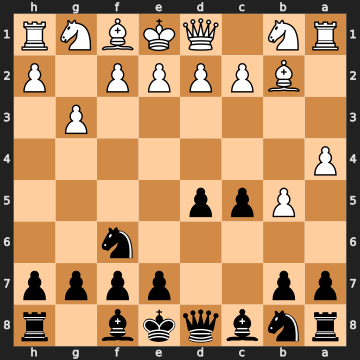
- Position before the move (FEN): `rnbqkb1r/pp2pppp/5n2/1Ppp4/P7/6P1/1BPPPP1P/RN1QKBNR b KQkq - 0 5`
- Played: **a6**; engine's first choice: **a6**
- Stored label: best; expected-score loss 0%; badges: none
- **No note shown** (routine move). The learner sees nothing for this move.
- Script checks: pass

| Silence appropriate (Y/N) | Missed an obvious problem (Y/N) | Comments |
| --- | --- | --- |
|  |  |  |

### 5 · G1 ply 13 · White · Mistake
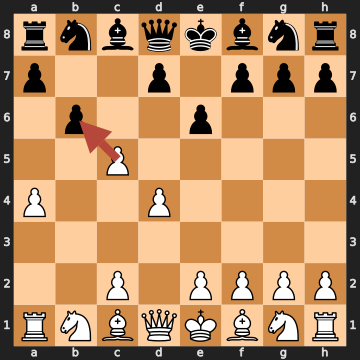
- Position before the move (FEN): `rnbqkb1r/1p2pppp/p4n2/1Pp5/P1Pp4/6P1/1B1PPP1P/RN1QKBNR w KQkq - 0 7`
- Played: **f4**; engine's first choice: **Nf3**
- Stored label: mistake; expected-score loss 29%; badges: none
- **Coach note:** This move is a mistake because it lets the opponent play a pawn to e5 and take control of the center.
- Suggestion 1 (reviewer notation Nf3): Consider moving your knight from g1 to f3, which is the strongest option here.
- Suggestion 2 (reviewer notation Bg2): Consider moving your bishop from f1 to g2, which is the strongest option here.
- Script checks: pass

| Correct and actionable (Y/N) | Illegal or confidently false claim (Y/N) | Comments |
| --- | --- | --- |
|  |  |  |

### 6 · G2 ply 23 · White · Mistake
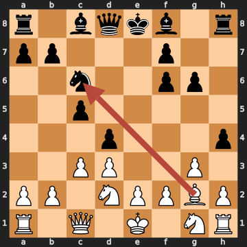
- Position before the move (FEN): `1rbqk2r/pp1nppb1/2np2p1/2p5/P1P1P2p/2NPBPP1/1P3N1P/1R1QKB1R w Kk - 2 12`
- Played: **Bg2**; engine's first choice: **Be2**
- Stored label: mistake; expected-score loss 21%; badges: none
- **Coach note:** This move is a mistake because it lets the opponent's bishop go to d4, which gives them the better position.
- Suggestion 1 (reviewer notation Be2): Consider moving your bishop from f1 to e2, which is the strongest option here.
- Script checks: pass

| Correct and actionable (Y/N) | Illegal or confidently false claim (Y/N) | Comments |
| --- | --- | --- |
|  |  |  |

### 7 · G2 ply 26 · Black · Miss

- Position before the move (FEN): `1rbqk2r/pp1npp2/2np2p1/2p5/P1PBP2p/2NP1PP1/1P3NBP/1R1QK2R b Kk - 0 13`
- Played: **Nxd4**; engine's first choice: **cxd4**
- Stored label: mistake; expected-score loss 30%; badges: miss
- **Coach note:** This was a missed chance. Your pawn on c5 takes the undefended bishop on d4, winning material for free.
- Suggestion 1 (reviewer notation cxd4): Consider moving your pawn from c5 to d4, which captures the opponent's bishop.
- Script checks: pass

| Correct and actionable (Y/N) | Illegal or confidently false claim (Y/N) | Comments |
| --- | --- | --- |
|  |  |  |

### 8 · G2 ply 30 · Black · Mistake
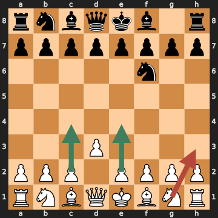
- Position before the move (FEN): `1rbqk2r/1p1npp2/p2p2p1/2p5/P1PnPPNp/2NP2P1/1P4BP/1R1QK2R b Kk - 1 15`
- Played: **hxg3**; engine's first choice: **e5**
- Stored label: mistake; expected-score loss 42%; badges: none
- **Coach note:** This move is a mistake because it leaves your pawn on g3 undefended, so the opponent's pawn on h2 can capture it.
- Suggestion 1 (reviewer notation e5): Consider moving your pawn from e7 to e5, which leaves none of your pieces undefended.
- Script checks: pass

| Correct and actionable (Y/N) | Illegal or confidently false claim (Y/N) | Comments |
| --- | --- | --- |
|  |  |  |

### 9 · G2 ply 31 · White · Miss
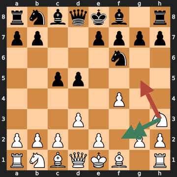
- Position before the move (FEN): `1rbqk2r/1p1npp2/p2p2p1/2p5/P1PnPPN1/2NP2p1/1P4BP/1R1QK2R w Kk - 0 16`
- Played: **h3**; engine's first choice: **hxg3**
- Stored label: mistake; expected-score loss 40%; badges: miss
- **Coach note:** This was a missed chance. Your pawn on h2 takes the undefended pawn on g3, winning material for free.
- Suggestion 1 (reviewer notation hxg3): Consider moving your pawn from h2 to g3, which captures the opponent's pawn.
- Script checks: pass

| Correct and actionable (Y/N) | Illegal or confidently false claim (Y/N) | Comments |
| --- | --- | --- |
|  |  |  |

### 10 · G2 ply 42 · Black · Miss

- Position before the move (FEN): `1rbqk2r/1p6/p2pp1n1/2p2p2/P1PN1P2/3P2pP/1PN3B1/1R1QK2R b Kk - 0 21`
- Played: **Qh4**; engine's first choice: **Nxf4**
- Stored label: blunder; expected-score loss 61%; badges: miss
- **Coach note:** This was a missed chance. Your knight on g6 takes the undefended pawn on f4, winning material for free.
- Suggestion 1 (reviewer notation Nxf4): Consider moving your knight from g6 to f4, which captures the opponent's pawn.
- Suggestion 2 (reviewer notation cxd4): Consider moving your pawn from c5 to d4, which captures the opponent's knight.
- Script checks: pass

| Correct and actionable (Y/N) | Illegal or confidently false claim (Y/N) | Comments |
| --- | --- | --- |
|  |  |  |

### 11 · G2 ply 49 · White · Great

- Position before the move (FEN): `1r2k2r/1p1b4/p2pp3/2p2p2/P1P4q/3PN1pP/1P1QN1n1/1R2K2R w Kk - 0 25`
- Played: **Nxg2**; engine's first choice: **Nxg2**
- Stored label: best; expected-score loss 0%; badges: great
- **Coach note:** Great move! Your knight on e3 takes the undefended knight on g2, winning material for free. It was the only move that kept your advantage.
- Script checks: pass

| Correct and actionable (Y/N) | Illegal or confidently false claim (Y/N) | Comments |
| --- | --- | --- |
|  |  |  |

### 12 · G3 ply 27 · White · Mistake
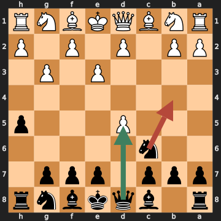
- Position before the move (FEN): `r2qk2r/p1p1n1p1/1p1bp3/3p3p/2PPp3/4P1PP/PP2QPB1/R1B2RK1 w kq - 0 14`
- Played: **a4**; engine's first choice: **cxd5**
- Stored label: mistake; expected-score loss 42%; badges: none
- **Coach note:** This move is a mistake: the opponent gets a clear edge from it, and a stronger option was available.
- Suggestion 1 (reviewer notation cxd5): Consider moving your pawn from c4 to d5, which captures the opponent's pawn.
- Script checks: pass

| Correct and actionable (Y/N) | Illegal or confidently false claim (Y/N) | Comments |
| --- | --- | --- |
|  |  |  |

### 13 · G3 ply 38 · Black · Mistake

- Position before the move (FEN): `r4rk1/p2q2p1/1ppbp3/1P1p1n1Q/P1PPp2P/4P2P/3B1PB1/R4RK1 b - - 2 19`
- Played: **Bc7**; engine's first choice: **Rf6**
- Stored label: mistake; expected-score loss 49%; badges: none
- **Coach note:** This move is a mistake because it lets the opponent's bishop go to b4, which gives them the better position.
- Suggestion 1 (reviewer notation Rf6): Consider moving your rook from f8 to f6, which is the strongest option here.
- Script checks: pass

| Correct and actionable (Y/N) | Illegal or confidently false claim (Y/N) | Comments |
| --- | --- | --- |
|  |  |  |

### 14 · G3 ply 39 · White · Great
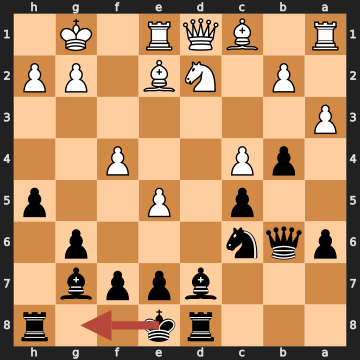
- Position before the move (FEN): `r4rk1/p1bq2p1/1pp1p3/1P1p1n1Q/P1PPp2P/4P2P/3B1PB1/R4RK1 w - - 3 20`
- Played: **Bb4**; engine's first choice: **Bb4**
- Stored label: best; expected-score loss 0%; badges: great
- **Coach note:** Well played! Every other move here gives away part of your advantage, so this was the one to find.
- Script checks: pass

| Correct and actionable (Y/N) | Illegal or confidently false claim (Y/N) | Comments |
| --- | --- | --- |
|  |  |  |

### 15 · G3 ply 44 · Black · Great
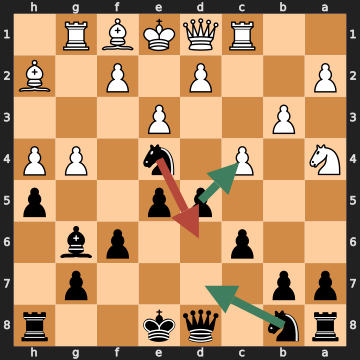
- Position before the move (FEN): `r5k1/p1b2rp1/1pq1p3/3P1n1Q/PB1Pp2P/4P2P/5PB1/R4RK1 b - - 0 22`
- Played: **exd5**; engine's first choice: **exd5**
- Stored label: best; expected-score loss 0%; badges: great
- **Coach note:** Great move! Your pawn on e6 takes the undefended pawn on d5, winning material for free. It was the only move that kept your advantage.
- Script checks: pass

| Correct and actionable (Y/N) | Illegal or confidently false claim (Y/N) | Comments |
| --- | --- | --- |
|  |  |  |

### 16 · G4 ply 13 · White · Mistake
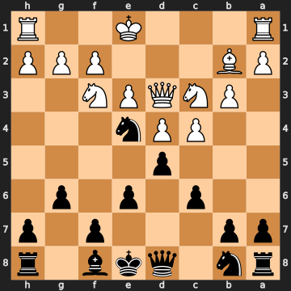
- Position before the move (FEN): `rnbqk1nr/p3bppp/1pp1p3/3p4/2P5/PPN1P3/1B1P1PPP/R2QKBNR w KQkq - 2 7`
- Played: **Qg4**; engine's first choice: **Nf3**
- Stored label: mistake; expected-score loss 12%; badges: none
- **Coach note:** This move is a mistake because it lets the opponent's bishop go to f6, which gives them the better position.
- Suggestion 1 (reviewer notation Nf3): Consider moving your knight from g1 to f3, which is the strongest option here.
- Suggestion 2 (reviewer notation g4): Consider moving your pawn from g2 to g4, which is the strongest option here.
- Script checks: pass

| Correct and actionable (Y/N) | Illegal or confidently false claim (Y/N) | Comments |
| --- | --- | --- |
|  |  |  |

### 17 · G4 ply 22 · Black · Mistake
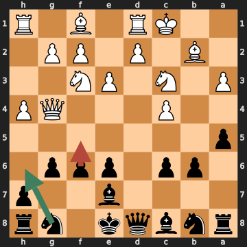
- Position before the move (FEN): `rnbqk1nr/4b2p/1pp1ppp1/p7/2P3QP/P1N1PN2/1B1P1PP1/2KR1B1R b kq - 1 11`
- Played: **f5**; engine's first choice: **Nh6**
- Stored label: mistake; expected-score loss 12%; badges: none
- **Coach note:** This move is a mistake because it lets the opponent's queen go to g3, which gives them the better position.
- Suggestion 1 (reviewer notation Nh6): Consider moving your knight from g8 to h6, which is the strongest option here.
- Script checks: pass

| Correct and actionable (Y/N) | Illegal or confidently false claim (Y/N) | Comments |
| --- | --- | --- |
|  |  |  |

### 18 · G4 ply 35 · White · Miss

- Position before the move (FEN): `2bqk1nr/r3b2p/1pp5/p1n1Qp1P/2P3p1/P1N2N2/1B1P1PP1/2K1RB1R w k - 0 18`
- Played: **Nd4**; engine's first choice: **Qxh8**
- Stored label: mistake; expected-score loss 11%; badges: miss
- **Coach note:** This was a missed chance. Your queen on e5 takes the undefended rook on h8, winning material for free.
- Suggestion 1 (reviewer notation Qxh8): Consider moving your queen from e5 to h8, which captures the opponent's rook.
- Suggestion 2 (reviewer notation Nd5): Consider moving your knight from c3 to d5, which is the strongest option here.
- Script checks: pass

| Correct and actionable (Y/N) | Illegal or confidently false claim (Y/N) | Comments |
| --- | --- | --- |
|  |  |  |

### 19 · G4 ply 44 · Black · Great

- Position before the move (FEN): `2b1k1nr/r3b2p/1p6/pp3p1P/2PB2p1/P7/3P1PP1/3KRB1R b k - 0 22`
- Played: **Nf6**; engine's first choice: **Nf6**
- Stored label: best; expected-score loss 0%; badges: great
- **Coach note:** Great move! It rescues your rook on h8, which was under attack. It was the only move that kept your advantage.
- Script checks: pass

| Correct and actionable (Y/N) | Illegal or confidently false claim (Y/N) | Comments |
| --- | --- | --- |
|  |  |  |

### 20 · G4 ply 45 · White · Great
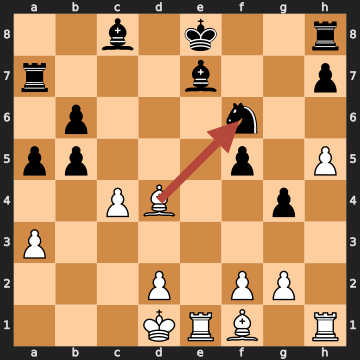
- Position before the move (FEN): `2b1k2r/r3b2p/1p3n2/pp3p1P/2PB2p1/P7/3P1PP1/3KRB1R w k - 1 23`
- Played: **Bxf6**; engine's first choice: **Bxf6**
- Stored label: best; expected-score loss 0%; badges: great
- **Coach note:** Great move! Your bishop on d4 captures the opponent's knight on f6. It was the only move that kept your advantage.
- Script checks: pass

| Correct and actionable (Y/N) | Illegal or confidently false claim (Y/N) | Comments |
| --- | --- | --- |
|  |  |  |

### 21 · G5 ply 3 · White · Mistake

- Position before the move (FEN): `rnbqkbnr/ppppp1pp/5p2/8/8/5P2/PPPPP1PP/RNBQKBNR w KQkq - 0 2`
- Played: **Kf2**; engine's first choice: **e4**
- Stored label: mistake; expected-score loss 32%; badges: none
- **Coach note:** This move is a mistake because it lets the opponent play a pawn to d5 and take control of the center.
- Suggestion 1 (reviewer notation e4): Consider moving your pawn from e2 to e4, which is the strongest option here.
- Suggestion 2 (reviewer notation c4): Consider moving your pawn from c2 to c4, which is the strongest option here.
- Script checks: pass

| Correct and actionable (Y/N) | Illegal or confidently false claim (Y/N) | Comments |
| --- | --- | --- |
|  |  |  |

### 22 · G5 ply 4 · Black · Mistake

- Position before the move (FEN): `rnbqkbnr/ppppp1pp/5p2/8/8/5P2/PPPPPKPP/RNBQ1BNR b kq - 1 2`
- Played: **e6**; engine's first choice: **d5**
- Stored label: mistake; expected-score loss 30%; badges: none
- **Coach note:** This move is a mistake because it lets the opponent play a pawn to d4 and take control of the center.
- Suggestion 1 (reviewer notation d5): Consider moving your pawn from d7 to d5, which is the strongest option here.
- Script checks: pass

| Correct and actionable (Y/N) | Illegal or confidently false claim (Y/N) | Comments |
| --- | --- | --- |
|  |  |  |

### 23 · G5 ply 5 · White · Routine (good)

- Position before the move (FEN): `rnbqkbnr/pppp2pp/4pp2/8/8/5P2/PPPPPKPP/RNBQ1BNR w kq - 0 3`
- Played: **e4**; engine's first choice: **d4**
- Stored label: good; expected-score loss 1%; badges: none
- **No note shown** (routine move). The learner sees nothing for this move.
- Script checks: pass

| Silence appropriate (Y/N) | Missed an obvious problem (Y/N) | Comments |
| --- | --- | --- |
|  |  |  |

### 24 · G5 ply 23 · White · Routine (best)
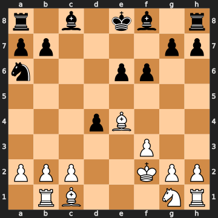
- Position before the move (FEN): `r1b1kb1r/pp4pp/n3pp2/8/3pB3/5P2/PPP2KPP/1RB3NR w kq - 2 12`
- Played: **Ne2**; engine's first choice: **Ne2**
- Stored label: best; expected-score loss 1%; badges: none
- **No note shown** (routine move). The learner sees nothing for this move.
- Script checks: pass

| Silence appropriate (Y/N) | Missed an obvious problem (Y/N) | Comments |
| --- | --- | --- |
|  |  |  |

### 25 · G5 ply 35 · White · Routine (inaccuracy)
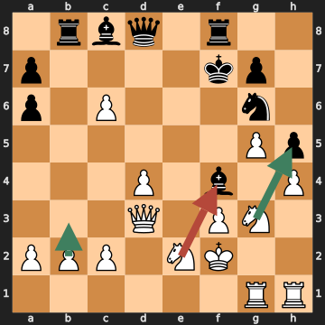
- Position before the move (FEN): `1rb4r/pp3kp1/nb2pp2/8/3pB1pP/3N1P2/PPPB1K2/1R5R w - - 0 18`
- Played: **h5**; engine's first choice: **fxg4**
- Stored label: inaccuracy; expected-score loss 10%; badges: none
- **No note shown** (routine move). The learner sees nothing for this move.
- Script checks: pass

| Silence appropriate (Y/N) | Missed an obvious problem (Y/N) | Comments |
| --- | --- | --- |
|  |  |  |

### 26 · G6 ply 17 · White · Mistake

- Position before the move (FEN): `r1bqk1nr/p3bpp1/1pnp4/2p1p2p/4P3/2NP2PP/PPP1NPB1/R1BQK2R w KQkq - 0 9`
- Played: **Bd2**; engine's first choice: **Nd5**
- Stored label: mistake; expected-score loss 21%; badges: none
- **Coach note:** This move is a mistake because it lets the opponent's knight go to f6, which gives them the better position.
- Suggestion 1 (reviewer notation Nd5): Consider moving your knight from c3 to d5, which is the strongest option here.
- Suggestion 2 (reviewer notation f4): Consider moving your pawn from f2 to f4, which is the strongest option here.
- Script checks: pass

| Correct and actionable (Y/N) | Illegal or confidently false claim (Y/N) | Comments |
| --- | --- | --- |
|  |  |  |

### 27 · G6 ply 23 · White · Miss

- Position before the move (FEN): `r2qk1nr/pb2bpp1/1p1p4/2p1p2p/4P3/P1NP2PP/1PPBnPB1/R2Q1RK1 w kq - 0 12`
- Played: **Nxe2**; engine's first choice: **Qxe2**
- Stored label: mistake; expected-score loss 23%; badges: miss
- **Coach note:** This was a missed chance. Your queen on d1 takes the undefended knight on e2, winning material for free.
- Suggestion 1 (reviewer notation Qxe2): Consider moving your queen from d1 to e2, which captures the opponent's knight.
- Script checks: pass

| Correct and actionable (Y/N) | Illegal or confidently false claim (Y/N) | Comments |
| --- | --- | --- |
|  |  |  |

### 28 · G6 ply 35 · White · Miss

- Position before the move (FEN): `1r2k2r/1b1qbpp1/1p1p1n2/p1p1p3/2P1P3/P1NP2pP/1P1BQPBK/1R3R2 w k - 0 18`
- Played: **Kg1**; engine's first choice: **fxg3**
- Stored label: blunder; expected-score loss 57%; badges: miss
- **Coach note:** This was a missed chance. Your pawn on f2 takes the undefended pawn on g3, winning material for free.
- Suggestion 1 (reviewer notation fxg3): Consider moving your pawn from f2 to g3, which captures the opponent's pawn.
- Script checks: pass

| Correct and actionable (Y/N) | Illegal or confidently false claim (Y/N) | Comments |
| --- | --- | --- |
|  |  |  |

### 29 · G7 ply 28 · Black · Great
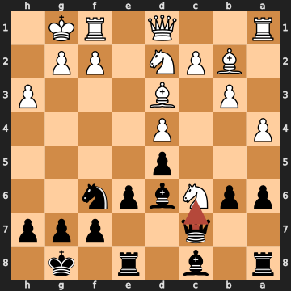
- Position before the move (FEN): `r1b1r1k1/2q2ppp/ppNbpn2/3p4/P2P4/1P1B3P/1BPN1PP1/R2Q1RK1 b - - 0 14`
- Played: **Qxc6**; engine's first choice: **Qxc6**
- Stored label: best; expected-score loss 0%; badges: great
- **Coach note:** Great move! Your queen on c7 takes the undefended knight on c6, winning material for free. It was the only move that kept your advantage.
- Script checks: pass

| Correct and actionable (Y/N) | Illegal or confidently false claim (Y/N) | Comments |
| --- | --- | --- |
|  |  |  |

### 30 · G7 ply 38 · Black · Great

- Position before the move (FEN): `r1br2k1/2q2ppp/pp2p3/3p4/PbPPR3/1P1B1N1P/5PP1/R1BQ2K1 b - - 0 19`
- Played: **dxe4**; engine's first choice: **dxe4**
- Stored label: best; expected-score loss 0%; badges: great
- **Coach note:** Great move! Your pawn on d5 captures the opponent's rook on e4. It was the only move that kept your advantage.
- Script checks: pass

| Correct and actionable (Y/N) | Illegal or confidently false claim (Y/N) | Comments |
| --- | --- | --- |
|  |  |  |

### 31 · G7 ply 40 · Black · Mistake

- Position before the move (FEN): `r1br2k1/2q2ppp/pp2p3/8/PbPPB3/1P3N1P/5PP1/R1BQ2K1 b - - 0 20`
- Played: **Bc3**; engine's first choice: **Bb7**
- Stored label: mistake; expected-score loss 42%; badges: none
- **Coach note:** This move is a mistake because it lets the opponent's bishop go to g5, which gives them the better position.
- Suggestion 1 (reviewer notation Bb7): Consider moving your bishop from c8 to b7, which is the strongest option here.
- Suggestion 2 (reviewer notation Rb8): Consider moving your rook from a8 to b8, which is the strongest option here.
- Script checks: pass

| Correct and actionable (Y/N) | Illegal or confidently false claim (Y/N) | Comments |
| --- | --- | --- |
|  |  |  |

### 32 · G7 ply 41 · White · Great

- Position before the move (FEN): `r1br2k1/2q2ppp/pp2p3/8/P1PPB3/1Pb2N1P/5PP1/R1BQ2K1 w - - 1 21`
- Played: **Bg5**; engine's first choice: **Bg5**
- Stored label: best; expected-score loss 0%; badges: great
- **Coach note:** Well played! Every other move here gives away part of your advantage, so this was the one to find.
- Script checks: pass

| Correct and actionable (Y/N) | Illegal or confidently false claim (Y/N) | Comments |
| --- | --- | --- |
|  |  |  |

### 33 · G7 ply 45 · White · Great
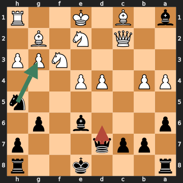
- Position before the move (FEN): `r2r2k1/1q3ppp/pp2p3/6B1/P1PP4/1Pb2N1P/5PP1/R2Q2K1 w - - 0 23`
- Played: **Rc1**; engine's first choice: **Rc1**
- Stored label: best; expected-score loss 0%; badges: great
- **Coach note:** Great move! It rescues your rook on a1, which was under attack. It was the only move that kept your advantage.
- Script checks: pass

| Correct and actionable (Y/N) | Illegal or confidently false claim (Y/N) | Comments |
| --- | --- | --- |
|  |  |  |

### 34 · G8 ply 5 · White · Miss

- Position before the move (FEN): `rnbqkbnr/p1pp1ppp/4p3/1p6/8/N6N/PPPPPPPP/R1BQKB1R w KQkq - 0 3`
- Played: **c3**; engine's first choice: **Nxb5**
- Stored label: mistake; expected-score loss 15%; badges: miss
- **Coach note:** This was a missed chance. Your knight on a3 takes the undefended pawn on b5, winning material for free.
- Suggestion 1 (reviewer notation Nxb5): Consider moving your knight from a3 to b5, which captures the opponent's pawn.
- Script checks: pass

| Correct and actionable (Y/N) | Illegal or confidently false claim (Y/N) | Comments |
| --- | --- | --- |
|  |  |  |

### 35 · G8 ply 16 · Black · Miss

- Position before the move (FEN): `rnb1kbnr/6pp/1qp1p3/pp1p1p2/P2PP3/2P4N/1PN2PPP/R1BQKB1R b KQkq - 0 8`
- Played: **fxe4**; engine's first choice: **dxe4**
- Stored label: mistake; expected-score loss 36%; badges: miss
- **Coach note:** This was a missed chance. Your pawn on d5 takes the undefended pawn on e4, winning material for free.
- Suggestion 1 (reviewer notation dxe4): Consider moving your pawn from d5 to e4, which captures the opponent's pawn.
- Script checks: pass

| Correct and actionable (Y/N) | Illegal or confidently false claim (Y/N) | Comments |
| --- | --- | --- |
|  |  |  |

### 36 · G8 ply 36 · Black · Great

- Position before the move (FEN): `r1b2rk1/4b1pp/1Nn1p3/p5B1/1p1P4/2P1nP2/1PN4P/R3KB1R b KQ - 0 18`
- Played: **Nxc2+**; engine's first choice: **Nxc2+**
- Stored label: best; expected-score loss 0%; badges: great
- **Coach note:** Great move! Your knight on e3 takes the undefended knight on c2, winning material for free. It was the only move that kept your advantage.
- Script checks: pass

| Correct and actionable (Y/N) | Illegal or confidently false claim (Y/N) | Comments |
| --- | --- | --- |
|  |  |  |

## Games analysed (PGN movetext)

1. G1: `1. b4 c6 2. a4 c5 3. b5 Nf6 4. Bb2 d5 5. g3 a6 6. c4 d4 7. f4 e5 8. fxe5 Ng4 9. Qc2 Nxe5 10. Nh3 h5 11. Na3 axb5 12. cxb5 Bd6 13. e3 d3 14. Qb3 Be6 15. Qc3 Nf3+ 16. Kf2 Be5 17. Qxc5 Nd7 18. Qb4 g5 19. b6 Nxd2 20. Bg2 Qf6+ 21. Kg1 Bxb2 22. Rb1 Bc3 23. Nb5 Nxb1 24. Nc7+ Kd8 25. Qb5 Nd2`
2. G2: `1. d3 Nf6 2. Nh3 c5 3. c4 h6 4. e4 d6 5. g3 h5 6. Nc3 g6 7. f3 Nc6 8. Rb1 Bg7 9. Be3 Rb8 10. a4 h4 11. Nf2 Nd7 12. Bg2 Bd4 13. Bxd4 Nxd4 14. f4 a6 15. Ng4 hxg3 16. h3 f5 17. exf5 gxf5 18. Ne3 Nf8 19. Ne2 e6 20. Nc2 Ng6 21. Nexd4 Qh4 22. Ne2 Nxf4 23. Ne3 Bd7 24. Qd2 Nxg2+ 25. Nxg2 Qg4`
3. G3: `1. g3 h5 2. e3 d5 3. Bg2 Nc6 4. d4 Nf6 5. Nf3 Bg4 6. h3 Bxf3 7. Qxf3 e6 8. c3 Ne4 9. Qe2 Bd6 10. O-O Ne7 11. c4 b6 12. Nd2 f5 13. Nxe4 fxe4 14. a4 Qd7 15. Bd2 c6 16. b4 h4 17. b5 O-O 18. gxh4 Nf5 19. Qh5 Bc7 20. Bb4 Rf7 21. bxc6 Qxc6 22. cxd5 exd5 23. Rac1 Qh6 24. Qxf7+ Kxf7 25. Rxc7+ Kg8`
4. G4: `1. b3 d6 2. e3 d5 3. c4 c6 4. Bb2 e6 5. a3 b6 6. Nc3 Be7 7. Qg4 g6 8. h4 a5 9. Nf3 dxc4 10. bxc4 f6 11. O-O-O f5 12. Qg3 Nd7 13. e4 Nc5 14. exf5 exf5 15. Re1 Ra7 16. h5 g5 17. Qe5 g4 18. Nd4 Qxd4 19. Qxd4 Nb3+ 20. Kd1 Nxd4 21. Nb5 cxb5 22. Bxd4 Nf6 23. Bxf6 O-O 24. Rxe7 Rd7 25. Rxd7 Rxf6`
5. G5: `1. f3 f6 2. Kf2 e6 3. e4 d5 4. d4 Ne7 5. Nc3 c6 6. Bd3 c5 7. exd5 Nxd5 8. Nxd5 Qxd5 9. Be4 Qxd4+ 10. Qxd4 cxd4 11. Rb1 Na6 12. Ne2 Bc5 13. Nf4 Kf7 14. Nd3 Bb6 15. g4 Rb8 16. h4 h5 17. Bd2 hxg4 18. h5 f5 19. h6 gxh6 20. b4 fxe4 21. fxe4 Bd7 22. b5 Nc5 23. Ne5+ Kg7 24. Rhf1 Nxe4+ 25. Kg2 Nxd2`
6. G6: `1. g3 h6 2. Bh3 c5 3. e4 d6 4. d3 h5 5. Bg2 Nc6 6. h3 e5 7. Nc3 Be7 8. Nge2 b6 9. Bd2 Bb7 10. a3 Nd4 11. O-O Nxe2+ 12. Nxe2 Nf6 13. c4 h4 14. Nc3 Qd7 15. Qe2 a5 16. Rab1 Rb8 17. Kh2 hxg3+ 18. Kg1 Rxh3 19. f4 Rh4 20. Rbe1 Qg4 21. Qxg4 Nxg4 22. Bc1 Nh2 23. f5 Kd7 24. Bd2 Rbh8 25. b3 R4h7`
7. G7: `1. h3 a6 2. a4 d5 3. Nf3 e6 4. e3 Nf6 5. d4 Bd6 6. b3 O-O 7. Be2 b6 8. Bb2 Qe7 9. Bd3 c5 10. O-O cxd4 11. exd4 Nc6 12. Nbd2 Re8 13. Ne5 Qc7 14. Nxc6 Qxc6 15. Re1 Rd8 16. Nf3 Qc7 17. Bc1 Ne4 18. c4 Bb4 19. Rxe4 dxe4 20. Bxe4 Bc3 21. Bg5 Bb7 22. Bxb7 Qxb7 23. Rc1 Bb2 24. Rc2 f6 25. Rxb2 fxg5`
8. G8: `1. Nh3 b5 2. Na3 e6 3. c3 c6 4. d4 f5 5. Nc2 d5 6. a4 Qb6 7. e3 a5 8. e4 fxe4 9. axb5 Nf6 10. f3 Be7 11. Bg5 exf3 12. gxf3 cxb5 13. Qd3 O-O 14. Qe2 b4 15. Nf4 Nc6 16. Qe3 Ng4 17. Nxd5 Nxe3 18. Nxb6 Nxc2+ 19. Kd2 Bxg5+ 20. Kxc2 Rb8 21. Rg1 Bf6 22. Nc4 bxc3 23. Kxc3 Bxd4+ 24. Kc2 Bxg1 25. f4 Rxf4`
