# S5 human coaching review sheet

Gate (plan.md S5, PRD section 7): human review of at least 30 positions, at least 90% correct and actionable (27 of 30), and zero illegal moves or confidently false tactical claims. Control rows check that quiet moves stay quiet.

Provenance: Stockfish 19, deep preset, one thread, seed 5. 30 annotated + 6 control positions. Script checks (legality, notation, counts): 36 of 36 pass.

How to review: read the board and the coach note. Mark *correct and actionable* only if a beginner would be told something true and useful. Mark the second column Y if any suggested move is illegal or any claim is false or overconfident. Notation appears here for you only; the learner sees plain words.

Tally: annotated rows with Y in the first column divided by annotated rows must be at least 0.90, and the second column must contain no Y.

### 1 · G1 ply 1 · White · Routine (good)

- Position before the move (FEN): `rnbqkbnr/pppppppp/8/8/8/8/PPPPPPPP/RNBQKBNR w KQkq - 0 1`
- Played: **b4**; engine's first choice: **e4**
- Stored label: good; expected-score loss 5%; badges: none
- **No note shown** (routine move). The learner sees nothing for this move.
- Script checks: pass

| Silence appropriate (Y/N) | Missed an obvious problem (Y/N) | Comments |
| --- | --- | --- |
|  |  |  |

### 2 · G1 ply 3 · White · Routine (inaccuracy)
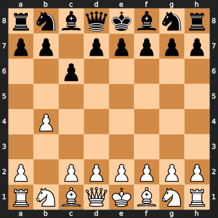
- Position before the move (FEN): `rnbqkbnr/pp1ppppp/2p5/8/1P6/8/P1PPPPPP/RNBQKBNR w KQkq - 0 2`
- Played: **a4**; engine's first choice: **e3**
- Stored label: inaccuracy; expected-score loss 5%; badges: none
- **No note shown** (routine move). The learner sees nothing for this move.
- Script checks: pass

| Silence appropriate (Y/N) | Missed an obvious problem (Y/N) | Comments |
| --- | --- | --- |
|  |  |  |

### 3 · G1 ply 4 · Black · Mistake
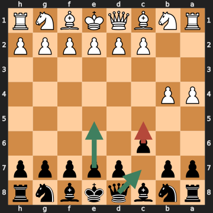
- Position before the move (FEN): `rnbqkbnr/pp1ppppp/2p5/8/PP6/8/2PPPPPP/RNBQKBNR b KQkq - 0 2`
- Played: **c5**; engine's first choice: **e5**
- Stored label: mistake; expected-score loss 13%; badges: none
- **Coach note:** This move is a mistake because it leaves your pawn on c5 undefended, so the opponent's pawn on b4 can capture it.
- Suggestion 1 (reviewer notation e5): Consider moving your pawn from e7 to e5, which leaves none of your pieces undefended.
- Suggestion 2 (reviewer notation Qc7): Consider moving your queen from d8 to c7, which leaves none of your pieces undefended.
- Script checks: pass

| Correct and actionable (Y/N) | Illegal or confidently false claim (Y/N) | Comments |
| --- | --- | --- |
|  |  |  |

### 4 · G1 ply 6 · Black · Blunder

- Position before the move (FEN): `rnbqkbnr/pp1ppppp/8/2P5/P7/8/2PPPPPP/RNBQKBNR b KQkq - 0 3`
- Played: **e6**; engine's first choice: **e5**
- Stored label: blunder; expected-score loss 33%; badges: none
- **Coach note:** This move is a blunder: it throws away a large part of your advantage.
- Suggestion 1 (reviewer notation e5): Consider moving your pawn from e7 to e5, which is the strongest option here.
- Script checks: pass

| Correct and actionable (Y/N) | Illegal or confidently false claim (Y/N) | Comments |
| --- | --- | --- |
|  |  |  |

### 5 · G1 ply 9 · White · Great

- Position before the move (FEN): `rnbqkbnr/p2p1ppp/1p2p3/2P5/P2P4/8/2P1PPPP/RNBQKBNR w KQkq - 0 5`
- Played: **cxb6**; engine's first choice: **cxb6**
- Stored label: best; expected-score loss 0%; badges: great
- **Coach note:** Well played! This was the one move that kept your position strong, and most other moves would have lost ground.
- Script checks: pass

| Correct and actionable (Y/N) | Illegal or confidently false claim (Y/N) | Comments |
| --- | --- | --- |
|  |  |  |

### 6 · G1 ply 11 · White · Routine (best)

- Position before the move (FEN): `rnbqkb1r/p2p1ppp/1P2pn2/8/P2P4/8/2P1PPPP/RNBQKBNR w KQkq - 1 6`
- Played: **bxa7**; engine's first choice: **bxa7**
- Stored label: best; expected-score loss 0%; badges: none
- **No note shown** (routine move). The learner sees nothing for this move.
- Script checks: pass

| Silence appropriate (Y/N) | Missed an obvious problem (Y/N) | Comments |
| --- | --- | --- |
|  |  |  |

### 7 · G1 ply 25 · White · Brilliant
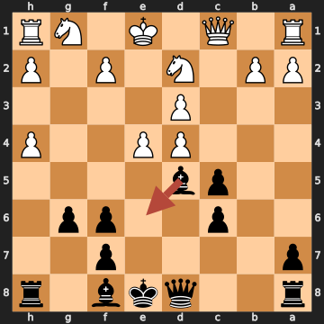
- Position before the move (FEN): `r5k1/rb1pbppp/n3pn2/q7/P2P4/2PBP3/3N1PPP/RNBQ1RK1 w - - 6 13`
- Played: **Ba3**; engine's first choice: **Nb3**
- Stored label: good; expected-score loss 0%; badges: brilliant
- **Coach note:** A bold idea! You gave up material on purpose, and the follow-up checks suggest it pays off.
- Script checks: pass

| Correct and actionable (Y/N) | Illegal or confidently false claim (Y/N) | Comments |
| --- | --- | --- |
|  |  |  |

### 8 · G2 ply 3 · White · Blunder

- Position before the move (FEN): `rnbqkb1r/pppppppp/5n2/8/8/3P4/PPP1PPPP/RNBQKBNR w KQkq - 1 2`
- Played: **Nh3**; engine's first choice: **e4**
- Stored label: blunder; expected-score loss 21%; badges: none
- **Coach note:** This move is a blunder: it throws away a large part of your advantage.
- Suggestion 1 (reviewer notation e4): Consider moving your pawn from e2 to e4, which is the strongest option here.
- Suggestion 2 (reviewer notation c4): Consider moving your pawn from c2 to c4, which is the strongest option here.
- Script checks: pass

| Correct and actionable (Y/N) | Illegal or confidently false claim (Y/N) | Comments |
| --- | --- | --- |
|  |  |  |

### 9 · G2 ply 7 · White · Mistake

- Position before the move (FEN): `rnbqkb1r/pp2pppp/5n2/2pp4/5P2/3P3N/PPP1P1PP/RNBQKB1R w KQkq - 0 4`
- Played: **Ng5**; engine's first choice: **Nf2**
- Stored label: mistake; expected-score loss 20%; badges: none
- **Coach note:** This move is a mistake: it gives up part of your advantage compared with the best option.
- Suggestion 1 (reviewer notation Nf2): Consider moving your knight from h3 to f2, which is the strongest option here.
- Suggestion 2 (reviewer notation g3): Consider moving your pawn from g2 to g3, which is the strongest option here.
- Script checks: pass

| Correct and actionable (Y/N) | Illegal or confidently false claim (Y/N) | Comments |
| --- | --- | --- |
|  |  |  |

### 10 · G2 ply 8 · Black · Mistake

- Position before the move (FEN): `rnbqkb1r/pp2pppp/5n2/2pp2N1/5P2/3P4/PPP1P1PP/RNBQKB1R b KQkq - 1 4`
- Played: **h6**; engine's first choice: **Nc6**
- Stored label: mistake; expected-score loss 16%; badges: none
- **Coach note:** This move is a mistake: it gives up part of your advantage compared with the best option.
- Suggestion 1 (reviewer notation Nc6): Consider moving your knight from b8 to c6, which is the strongest option here.
- Script checks: pass

| Correct and actionable (Y/N) | Illegal or confidently false claim (Y/N) | Comments |
| --- | --- | --- |
|  |  |  |

### 11 · G2 ply 24 · Black · Great

- Position before the move (FEN): `1rb1kb1r/p3pp2/2n2npp/qpp5/2P2P2/N3PN2/PP1QB1PP/R1B1K2R b KQk - 2 12`
- Played: **b4**; engine's first choice: **b4**
- Stored label: best; expected-score loss 0%; badges: great
- **Coach note:** Well played! This was the one move that kept your position strong, and most other moves would have lost ground.
- Script checks: pass

| Correct and actionable (Y/N) | Illegal or confidently false claim (Y/N) | Comments |
| --- | --- | --- |
|  |  |  |

### 12 · G2 ply 33 · White · Blunder

- Position before the move (FEN): `1r2kb1r/p3pp2/1qn3pp/2p2b2/1pP2P2/4P3/PP1NB1PP/R1BQK2R w KQk - 1 17`
- Played: **O-O**; engine's first choice: **e4**
- Stored label: blunder; expected-score loss 36%; badges: none
- **Coach note:** This move is a blunder: it throws away a large part of your advantage.
- Suggestion 1 (reviewer notation e4): Consider moving your pawn from e3 to e4, which is the strongest option here.
- Script checks: pass

| Correct and actionable (Y/N) | Illegal or confidently false claim (Y/N) | Comments |
| --- | --- | --- |
|  |  |  |

### 13 · G2 ply 36 · Black · Blunder
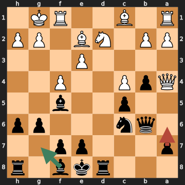
- Position before the move (FEN): `3rkb1r/p3pp2/1qn3pp/2p2b2/QpP2P2/4P3/PP1NB1PP/R1B2RK1 b k - 4 18`
- Played: **a6**; engine's first choice: **Bg7**
- Stored label: blunder; expected-score loss 42%; badges: none
- **Coach note:** This move is a blunder: it throws away a large part of your advantage.
- Suggestion 1 (reviewer notation Bg7): Consider moving your bishop from f8 to g7, which is the strongest option here.
- Script checks: pass

| Correct and actionable (Y/N) | Illegal or confidently false claim (Y/N) | Comments |
| --- | --- | --- |
|  |  |  |

### 14 · G2 ply 46 · Black · Great

- Position before the move (FEN): `3rk2r/3bppb1/pqn3p1/2p1P2p/1pP2P2/P7/1P1NB1PP/R1BQR1K1 b k - 0 23`
- Played: **O-O**; engine's first choice: **O-O**
- Stored label: best; expected-score loss 0%; badges: great
- **Coach note:** Well played! This was the one move that kept your position strong, and most other moves would have lost ground.
- Script checks: pass

| Correct and actionable (Y/N) | Illegal or confidently false claim (Y/N) | Comments |
| --- | --- | --- |
|  |  |  |

### 15 · G3 ply 23 · White · Great

- Position before the move (FEN): `2kr3r/pppbqpp1/2nb1n2/7p/4p3/P1NPPNPP/1PP1QPB1/R1B1K2R w KQ - 0 12`
- Played: **Nd2**; engine's first choice: **Nd2**
- Stored label: best; expected-score loss 0%; badges: great
- **Coach note:** Well played! This was the one move that kept your position strong, and most other moves would have lost ground.
- Script checks: pass

| Correct and actionable (Y/N) | Illegal or confidently false claim (Y/N) | Comments |
| --- | --- | --- |
|  |  |  |

### 16 · G4 ply 20 · Black · Routine (best)

- Position before the move (FEN): `rn1qkb1r/pp3p1p/2p1p1p1/3p4/2PPn3/1PNQPN2/PB3PPP/R3K2R b KQkq - 1 10`
- Played: **f5**; engine's first choice: **f5**
- Stored label: best; expected-score loss 0%; badges: none
- **No note shown** (routine move). The learner sees nothing for this move.
- Script checks: pass

| Silence appropriate (Y/N) | Missed an obvious problem (Y/N) | Comments |
| --- | --- | --- |
|  |  |  |

### 17 · G4 ply 31 · White · Routine (good)

- Position before the move (FEN): `r4rk1/pp1n3p/2p1p1pb/1P1p1p2/PqPPn3/2NQPN1P/1B3PP1/R4RK1 w - - 1 16`
- Played: **Nxe4**; engine's first choice: **Rfb1**
- Stored label: good; expected-score loss 2%; badges: none
- **No note shown** (routine move). The learner sees nothing for this move.
- Script checks: pass

| Silence appropriate (Y/N) | Missed an obvious problem (Y/N) | Comments |
| --- | --- | --- |
|  |  |  |

### 18 · G4 ply 36 · Black · Great

- Position before the move (FEN): `r4rk1/pp1n3p/4p1pb/1Ppp4/PQPPp3/4PN1P/1B3PP1/R4RK1 b - - 0 18`
- Played: **cxb4**; engine's first choice: **cxb4**
- Stored label: best; expected-score loss 0%; badges: great
- **Coach note:** Well played! This was the one move that kept your position strong, and most other moves would have lost ground.
- Script checks: pass

| Correct and actionable (Y/N) | Illegal or confidently false claim (Y/N) | Comments |
| --- | --- | --- |
|  |  |  |

### 19 · G4 ply 41 · White · Great
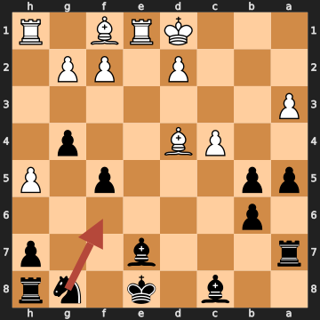
- Position before the move (FEN): `r1r3k1/p2n3p/1p2p1pb/1PPp4/Pp1Pp3/4P2P/1B1N1PP1/R4RK1 w - - 0 21`
- Played: **c6**; engine's first choice: **c6**
- Stored label: best; expected-score loss 0%; badges: great
- **Coach note:** Well played! This was the one move that kept your position strong, and most other moves would have lost ground.
- Script checks: pass

| Correct and actionable (Y/N) | Illegal or confidently false claim (Y/N) | Comments |
| --- | --- | --- |
|  |  |  |

### 20 · G4 ply 47 · White · Mistake

- Position before the move (FEN): `r1r2nk1/p6p/2P1p1p1/pP1p2b1/1p1Pp3/4P2P/1B1N1PP1/R1R3K1 w - - 2 24`
- Played: **Nb3**; engine's first choice: **Rxa5**
- Stored label: mistake; expected-score loss 13%; badges: none
- **Coach note:** This move is a mistake: it gives up part of your advantage compared with the best option.
- Suggestion 1 (reviewer notation Rxa5): Consider moving your rook from a1 to a5, which captures the opponent's pawn.
- Script checks: pass

| Correct and actionable (Y/N) | Illegal or confidently false claim (Y/N) | Comments |
| --- | --- | --- |
|  |  |  |

### 21 · G5 ply 2 · Black · Mistake

- Position before the move (FEN): `rnbqkbnr/pppppppp/8/8/8/5P2/PPPPP1PP/RNBQKBNR b KQkq - 0 1`
- Played: **f6**; engine's first choice: **e5**
- Stored label: mistake; expected-score loss 17%; badges: none
- **Coach note:** This move is a mistake: it gives up part of your advantage compared with the best option.
- Suggestion 1 (reviewer notation e5): Consider moving your pawn from e7 to e5, which is the strongest option here.
- Script checks: pass

| Correct and actionable (Y/N) | Illegal or confidently false claim (Y/N) | Comments |
| --- | --- | --- |
|  |  |  |

### 22 · G5 ply 3 · White · Blunder

- Position before the move (FEN): `rnbqkbnr/ppppp1pp/5p2/8/8/5P2/PPPPP1PP/RNBQKBNR w KQkq - 0 2`
- Played: **Kf2**; engine's first choice: **e4**
- Stored label: blunder; expected-score loss 35%; badges: none
- **Coach note:** This move is a blunder: it throws away a large part of your advantage.
- Suggestion 1 (reviewer notation e4): Consider moving your pawn from e2 to e4, which is the strongest option here.
- Suggestion 2 (reviewer notation d4): Consider moving your pawn from d2 to d4, which is the strongest option here.
- Script checks: pass

| Correct and actionable (Y/N) | Illegal or confidently false claim (Y/N) | Comments |
| --- | --- | --- |
|  |  |  |

### 23 · G5 ply 4 · Black · Blunder

- Position before the move (FEN): `rnbqkbnr/ppppp1pp/5p2/8/8/5P2/PPPPPKPP/RNBQ1BNR b kq - 1 2`
- Played: **e6**; engine's first choice: **d5**
- Stored label: blunder; expected-score loss 27%; badges: none
- **Coach note:** This move is a blunder: it throws away a large part of your advantage.
- Suggestion 1 (reviewer notation d5): Consider moving your pawn from d7 to d5, which is the strongest option here.
- Script checks: pass

| Correct and actionable (Y/N) | Illegal or confidently false claim (Y/N) | Comments |
| --- | --- | --- |
|  |  |  |

### 24 · G5 ply 38 · Black · Routine (inaccuracy)

- Position before the move (FEN): `r1b1k2r/p3q1pp/2p1pn2/1P6/1n1P1B2/5PPN/1R3K1P/3Q1B1R b kq - 0 19`
- Played: **Nfd5**; engine's first choice: **O-O**
- Stored label: inaccuracy; expected-score loss 6%; badges: none
- **No note shown** (routine move). The learner sees nothing for this move.
- Script checks: pass

| Silence appropriate (Y/N) | Missed an obvious problem (Y/N) | Comments |
| --- | --- | --- |
|  |  |  |

### 25 · G5 ply 43 · White · Blunder

- Position before the move (FEN): `r3k2r/p2bq1pp/2n1p3/1B1n4/3P1B2/5PPN/1R3K1P/3Q3R w kq - 2 22`
- Played: **Qa4**; engine's first choice: **Ng5**
- Stored label: blunder; expected-score loss 47%; badges: none
- **Coach note:** This move is a blunder: it throws away a large part of your advantage.
- Suggestion 1 (reviewer notation Ng5): Consider moving your knight from h3 to g5, which is the strongest option here.
- Script checks: pass

| Correct and actionable (Y/N) | Illegal or confidently false claim (Y/N) | Comments |
| --- | --- | --- |
|  |  |  |

### 26 · G5 ply 46 · Black · Blunder
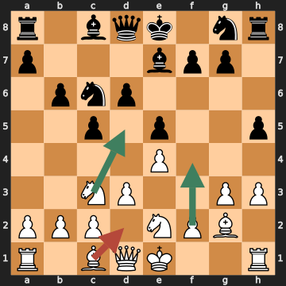
- Position before the move (FEN): `r3k2r/p2bq1pp/1nn1p3/1B6/3P1B2/5PPN/1RQ2K1P/7R b kq - 5 23`
- Played: **Rc8**; engine's first choice: **Nxd4**
- Stored label: blunder; expected-score loss 41%; badges: none
- **Coach note:** This move is a blunder: it throws away a large part of your advantage.
- Suggestion 1 (reviewer notation Nxd4): Consider moving your knight from c6 to d4, which captures the opponent's pawn.
- Script checks: pass

| Correct and actionable (Y/N) | Illegal or confidently false claim (Y/N) | Comments |
| --- | --- | --- |
|  |  |  |

### 27 · G5 ply 49 · White · Mistake
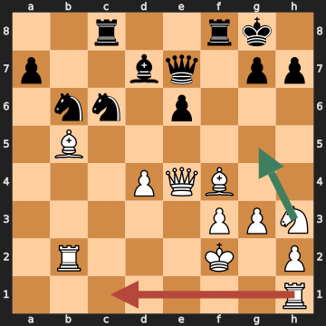
- Position before the move (FEN): `2r2rk1/p2bq1pp/1nn1p3/1B6/3PQB2/5PPN/1R3K1P/7R w - - 8 25`
- Played: **Rc1**; engine's first choice: **Ng5**
- Stored label: mistake; expected-score loss 17%; badges: none
- **Coach note:** This move is a mistake: it gives up part of your advantage compared with the best option.
- Suggestion 1 (reviewer notation Ng5): Consider moving your knight from h3 to g5, which is the strongest option here.
- Script checks: pass

| Correct and actionable (Y/N) | Illegal or confidently false claim (Y/N) | Comments |
| --- | --- | --- |
|  |  |  |

### 28 · G5 ply 50 · Black · Great
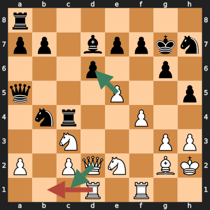
- Position before the move (FEN): `2r2rk1/p2bq1pp/1nn1p3/1B6/3PQB2/5PPN/1R3K1P/2R5 b - - 9 25`
- Played: **Nd5**; engine's first choice: **Nd5**
- Stored label: best; expected-score loss 0%; badges: great
- **Coach note:** Well played! This was the one move that kept your position strong, and most other moves would have lost ground.
- Script checks: pass

| Correct and actionable (Y/N) | Illegal or confidently false claim (Y/N) | Comments |
| --- | --- | --- |
|  |  |  |

### 29 · G6 ply 41 · White · Mistake

- Position before the move (FEN): `3bk2r/rq1p1pp1/2nnp3/1p2N2p/1PpP1P2/P1N1P1P1/1B2Q2P/1R3RK1 w k - 3 21`
- Played: **Nf3**; engine's first choice: **Rbd1**
- Stored label: mistake; expected-score loss 17%; badges: none
- **Coach note:** This move is a mistake: it gives up part of your advantage compared with the best option.
- Suggestion 1 (reviewer notation Rbd1): Consider moving your rook from b1 to d1, which is the strongest option here.
- Suggestion 2 (reviewer notation d5): Consider moving your pawn from d4 to d5, which is the strongest option here.
- Script checks: pass

| Correct and actionable (Y/N) | Illegal or confidently false claim (Y/N) | Comments |
| --- | --- | --- |
|  |  |  |

### 30 · G6 ply 48 · Black · Blunder

- Position before the move (FEN): `3bk2r/rq1p1p2/3np3/1p3npp/1PpP1P2/P1N1P1P1/1B1NQ2P/3RR1K1 b k - 1 24`
- Played: **h4**; engine's first choice: **gxf4**
- Stored label: blunder; expected-score loss 34%; badges: none
- **Coach note:** This move is a blunder: it throws away a large part of your advantage.
- Suggestion 1 (reviewer notation gxf4): Consider moving your pawn from g5 to f4, which captures the opponent's pawn.
- Script checks: pass

| Correct and actionable (Y/N) | Illegal or confidently false claim (Y/N) | Comments |
| --- | --- | --- |
|  |  |  |

### 31 · G6 ply 50 · Black · Mistake

- Position before the move (FEN): `3bk2r/rq1p1p2/3np3/1p1P1np1/1Pp2P1p/P1N1P1P1/1B1NQ2P/3RR1K1 b k - 0 25`
- Played: **gxf4**; engine's first choice: **hxg3**
- Stored label: mistake; expected-score loss 17%; badges: none
- **Coach note:** This move is a mistake because it leaves your pawn on f4 undefended, so the opponent's pawn on g3 can capture it.
- Suggestion 1 (reviewer notation hxg3): Consider moving your pawn from h4 to g3, which captures the opponent's pawn.
- Script checks: pass

| Correct and actionable (Y/N) | Illegal or confidently false claim (Y/N) | Comments |
| --- | --- | --- |
|  |  |  |

### 32 · G7 ply 13 · White · Blunder

- Position before the move (FEN): `r2qkbnr/1pp2pp1/p1n5/3ppb1p/P7/2PP1N1P/1P1NPPP1/R1BQKB1R w KQkq - 0 7`
- Played: **Qc2**; engine's first choice: **e4**
- Stored label: blunder; expected-score loss 22%; badges: none
- **Coach note:** This move is a blunder: it throws away a large part of your advantage.
- Suggestion 1 (reviewer notation e4): Consider moving your pawn from e2 to e4, which is the strongest option here.
- Script checks: pass

| Correct and actionable (Y/N) | Illegal or confidently false claim (Y/N) | Comments |
| --- | --- | --- |
|  |  |  |

### 33 · G7 ply 28 · Black · Mistake

- Position before the move (FEN): `r3kbnr/1pp5/p2qbp2/4p1pp/P3P3/1N1P3P/1P2BPP1/R1BQK2R b KQkq - 0 14`
- Played: **O-O-O**; engine's first choice: **Qb6**
- Stored label: mistake; expected-score loss 18%; badges: none
- **Coach note:** This move is a mistake: it gives up part of your advantage compared with the best option.
- Suggestion 1 (reviewer notation Qb6): Consider moving your queen from d6 to b6, which is the strongest option here.
- Suggestion 2 (reviewer notation Qb4+): Consider moving your queen from d6 to b4, which gives check.
- Script checks: pass

| Correct and actionable (Y/N) | Illegal or confidently false claim (Y/N) | Comments |
| --- | --- | --- |
|  |  |  |

### 34 · G7 ply 30 · Black · Great
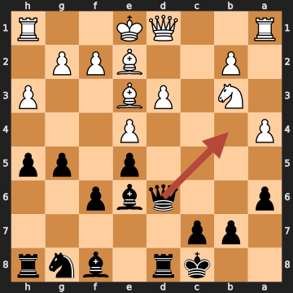
- Position before the move (FEN): `2kr1bnr/1pp5/p2qbp2/4p1pp/P3P3/1N1PB2P/1P2BPP1/R2QK2R b KQ - 2 15`
- Played: **Qb4+**; engine's first choice: **Qb4+**
- Stored label: best; expected-score loss 0%; badges: great
- **Coach note:** Well played! This was the one move that kept your position strong, and most other moves would have lost ground.
- Script checks: pass

| Correct and actionable (Y/N) | Illegal or confidently false claim (Y/N) | Comments |
| --- | --- | --- |
|  |  |  |

### 35 · G7 ply 35 · White · Mistake
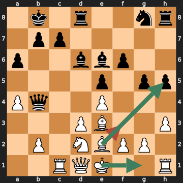
- Position before the move (FEN): `1k1r2nr/1pp5/p2bbp2/4p1pp/Pq2P3/3PB2P/1P1NBPP1/2RQK2R w K - 7 18`
- Played: **Bf3**; engine's first choice: **O-O**
- Stored label: mistake; expected-score loss 13%; badges: none
- **Coach note:** This move is a mistake because it leaves your pawn on b2 undefended, so the opponent's queen on b4 can capture it.
- Suggestion 1 (reviewer notation O-O): Consider moving your king from e1 to g1, which is the strongest option here.
- Suggestion 2 (reviewer notation Bxh5): Consider moving your bishop from e2 to h5, which captures the opponent's pawn.
- Script checks: pass

| Correct and actionable (Y/N) | Illegal or confidently false claim (Y/N) | Comments |
| --- | --- | --- |
|  |  |  |

### 36 · G7 ply 37 · White · Great
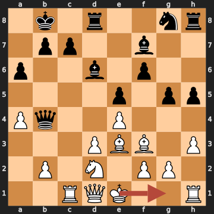
- Position before the move (FEN): `1k1r2nr/1pp2b2/p2b1p2/4p1pp/Pq2P3/3PBB1P/1P1N1PP1/2RQK2R w K - 9 19`
- Played: **O-O**; engine's first choice: **O-O**
- Stored label: best; expected-score loss 0%; badges: great
- **Coach note:** Well played! This was the one move that kept your position strong, and most other moves would have lost ground.
- Script checks: pass

| Correct and actionable (Y/N) | Illegal or confidently false claim (Y/N) | Comments |
| --- | --- | --- |
|  |  |  |

## Games analysed (PGN movetext)

1. G1: `1. b4 c6 2. a4 c5 3. bxc5 e6 4. d4 b6 5. cxb6 Nf6 6. bxa7 Na6 7. Nf3 Be7 8. c3 O-O 9. e3 Rxa7 10. Bd3 Qa5 11. Nfd2 Bb7 12. O-O Rfa8 13. Ba3 Qd8 14. Qc2 h5 15. Bxe7 Qxe7 16. Rc1 Nc7 17. c4 d5 18. c5 e5 19. Bf1 Ba6 20. Nc3 Ng4 21. h3 exd4 22. exd4 Ne6 23. Nb3 Nh6 24. Bxa6 Rxa6 25. Nxd5 Qg5`
2. G2: `1. d3 Nf6 2. Nh3 c5 3. f4 d5 4. Ng5 h6 5. Nf3 Nc6 6. Na3 Rb8 7. e3 g6 8. c3 b5 9. Be2 Qc7 10. c4 dxc4 11. dxc4 Qa5+ 12. Qd2 b4 13. Nb1 Bf5 14. Qd1 Ne4 15. Nbd2 Nxd2 16. Nxd2 Qb6 17. O-O Rd8 18. Qa4 a6 19. e4 Bc8 20. e5 h5 21. Re1 Bd7 22. Qd1 Bg7 23. a3 O-O 24. Nf3 Bf5 25. Bd2 b3`
3. G3: `1. g3 h5 2. e3 d5 3. Bg2 Nc6 4. Nc3 e6 5. Qe2 Bd6 6. a3 Bd7 7. Nf3 e5 8. Nxd5 Nf6 9. Nc3 Qe7 10. d3 O-O-O 11. h3 e4 12. Nd2 h4 13. g4 exd3 14. cxd3 Ne8 15. d4 g5 16. Nb3 f6 17. e4 Kb8 18. Qd1 Ng7 19. Be3 Bf4 20. Nd5 Qe8 21. Bxf4 gxf4 22. Nc5 f3 23. Qxf3 Nxd4 24. Qc3 Bc6 25. O-O Ne2+`
4. G4: `1. b3 d6 2. e3 d5 3. c4 c6 4. d4 Nf6 5. Qc2 g6 6. Nf3 Bf5 7. Bd3 Bxd3 8. Qxd3 Ne4 9. Bb2 e6 10. Nc3 f5 11. O-O Bh6 12. a4 O-O 13. b4 Nd7 14. b5 Qa5 15. h3 Qb4 16. Nxe4 fxe4 17. Qd2 c5 18. Qxb4 cxb4 19. Nd2 Rfc8 20. c5 b6 21. c6 Nf8 22. a5 bxa5 23. Rfc1 Bg5 24. Nb3 Bd8 25. Nxa5 Bc7`
5. G5: `1. f3 f6 2. Kf2 e6 3. d4 d5 4. c3 c6 5. e3 f5 6. c4 Bd6 7. g3 Qe7 8. Nc3 dxc4 9. Nh3 b5 10. e4 fxe4 11. Nxe4 Na6 12. b3 cxb3 13. Bg5 Qd7 14. Nxd6+ Qxd6 15. Bf4 Qe7 16. a4 Nf6 17. axb5 b2 18. Ra2 Nb4 19. Rxb2 Nfd5 20. bxc6 Nxc6 21. Bb5 Bd7 22. Qa4 Nb6 23. Qc2 Rc8 24. Qe4 O-O 25. Rc1 Nd5`
6. G6: `1. g3 h6 2. Bh3 c5 3. c4 Nf6 4. Nf3 b6 5. O-O e6 6. Nc3 a6 7. e3 Bb7 8. Bg2 b5 9. cxb5 Qb6 10. Qe2 Ne4 11. Rb1 axb5 12. Ne5 Nd6 13. Bxb7 Qxb7 14. b4 c4 15. f4 Be7 16. a3 Nc6 17. Bb2 Bf6 18. Qg2 h5 19. d4 Ra7 20. Qe2 Bd8 21. Nf3 Ne7 22. Nd2 Nef5 23. Rfe1 g5 24. Rbd1 h4 25. d5 gxf4`
7. G7: `1. h3 a6 2. a4 d5 3. Nf3 Nc6 4. d3 h5 5. c3 Bf5 6. Nbd2 e5 7. Qc2 d4 8. Nb3 Be6 9. e4 f6 10. Be2 Qd6 11. Nfd2 g5 12. cxd4 Nxd4 13. Qd1 Nxb3 14. Nxb3 O-O-O 15. Be3 Qb4+ 16. Nd2 Kb8 17. Rc1 Bd6 18. Bf3 Bf7 19. O-O c6 20. Nc4 Bc7 21. Be2 Be6 22. Rc3 Nh6 23. Qc2 g4 24. Nd2 Qf8 25. b4 Rg8`
8. G8: `1. Nh3 b5 2. Na3 e6 3. c3 b4 4. Nc2 Nc6 5. c4 d5 6. g3 Nf6 7. Bg2 Be7 8. O-O O-O 9. cxd5 b3 10. dxc6 bxc2 11. Qxc2 Qd4 12. e3 Qb6 13. Re1 Qa5 14. Rd1 e5 15. b3 Nd5 16. a3 Nb6 17. Bb2 Bf6 18. f3 Be6 19. Nf2 Rfd8 20. Ne4 Qd5 21. Rdb1 Qxb3 22. Qc3 Rab8 23. a4 Nc4 24. Qxb3 Rxb3 25. Bc3 Rb6`
